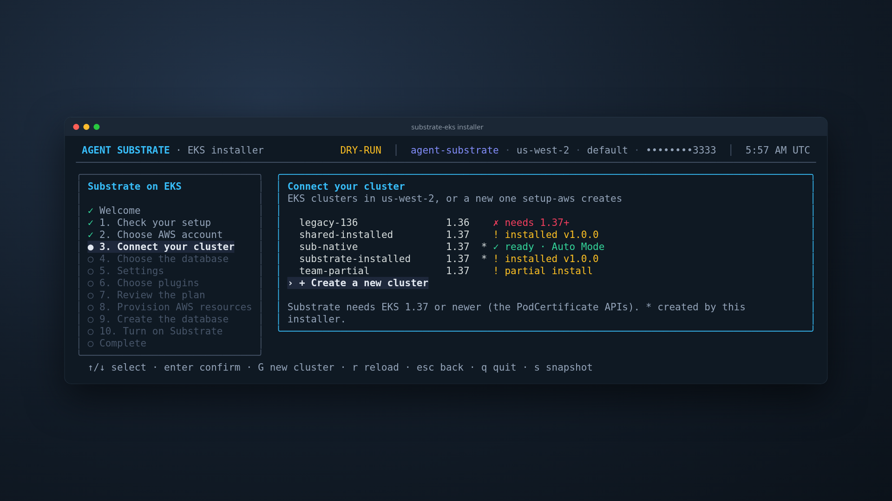
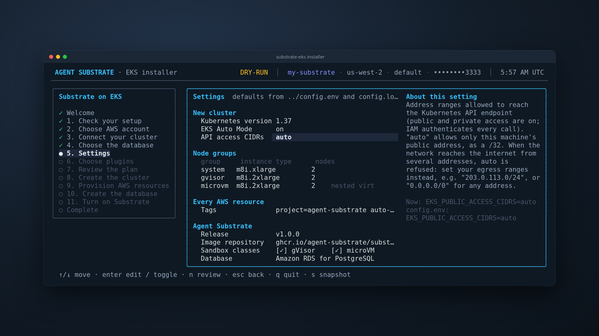
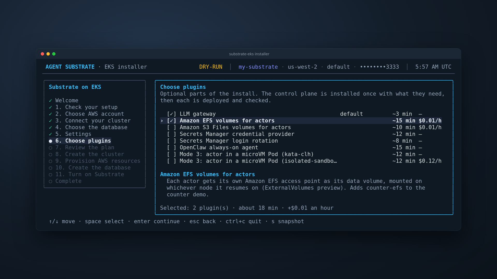
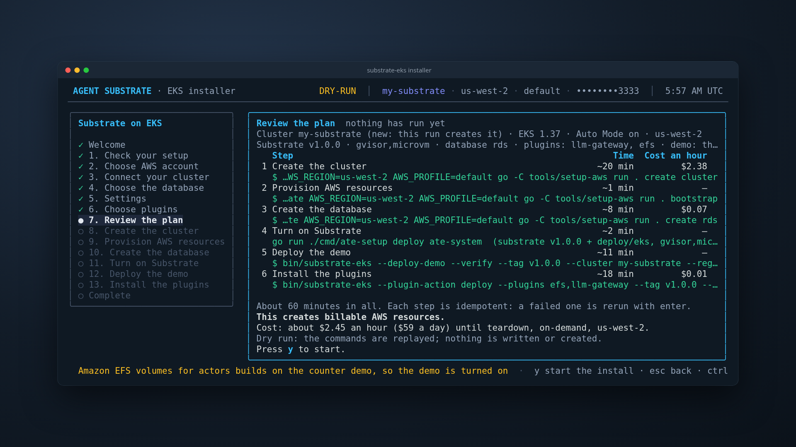
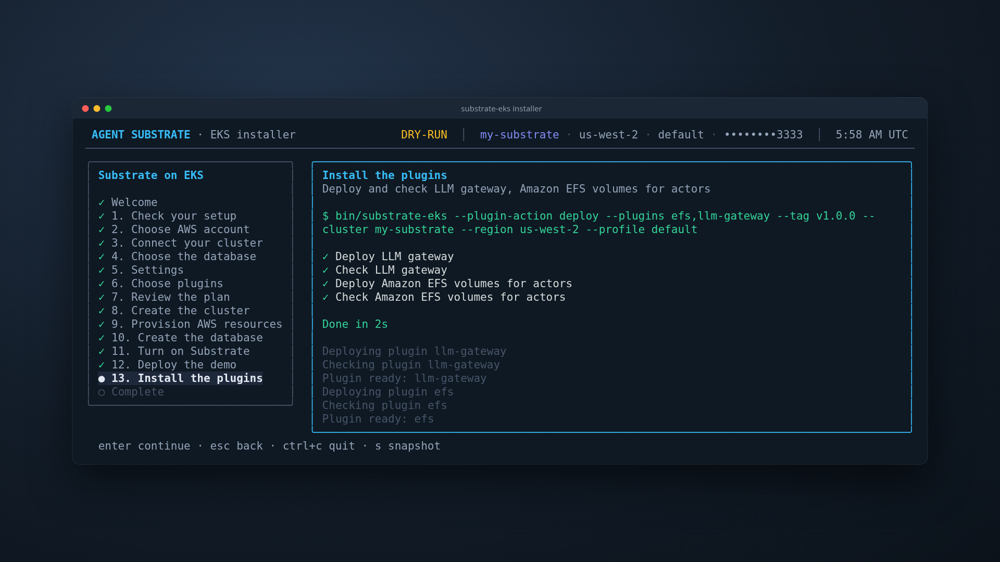
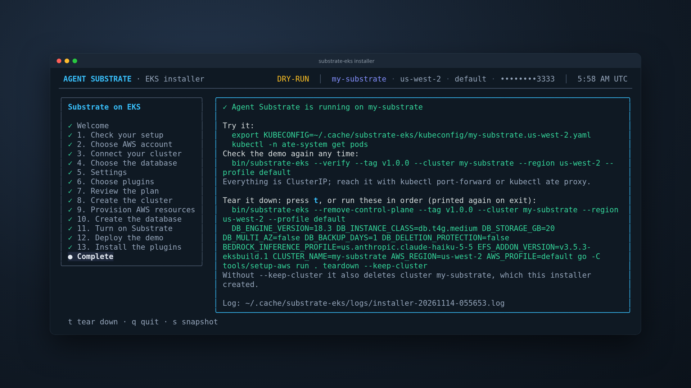
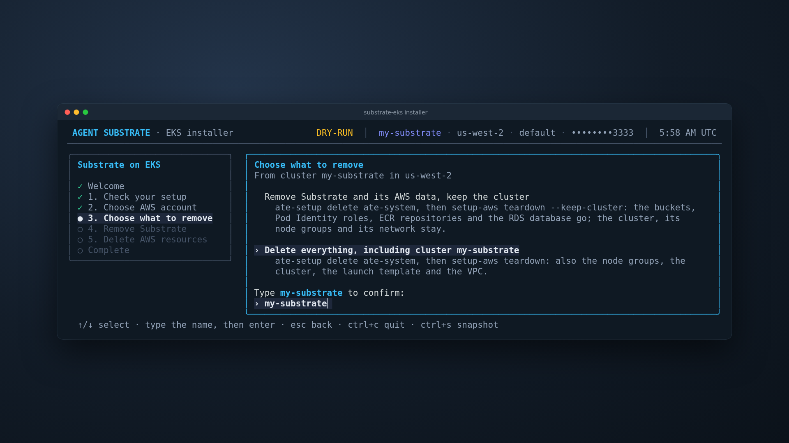
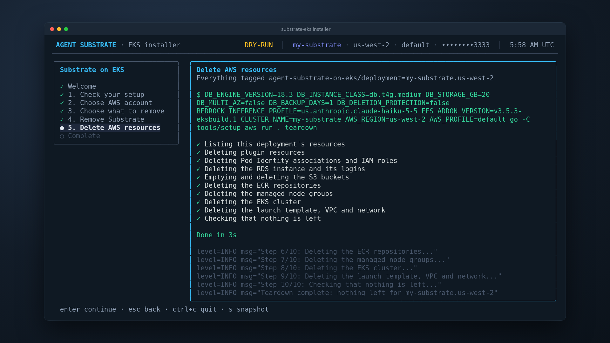

# Agent Substrate on Amazon EKS

Run [Agent Substrate](https://github.com/agent-substrate/substrate) on Amazon
EKS with the AWS services it needs: Amazon S3 for actor snapshots, Amazon RDS
for PostgreSQL for state, AWS Secrets Manager for database logins, EKS Pod
Identity for every AWS call, Amazon ECR for images, and Amazon Bedrock for
agent inference. Actors run in gVisor sandboxes and in microVMs (Kata
Containers on Cloud Hypervisor) on EC2 instances with nested virtualization.

One Go installer does all of it: an interactive wizard over Go code that
calls AWS through the AWS SDK and installs Agent Substrate with upstream's
`ate-setup`. It follows the architecture of
[substrate-gke](https://github.com/ai-on-gke/substrate-gke)'s installer, and
no install step runs a shell script.

No application is exposed: every Service is ClusterIP, the database and
buckets are private, and you reach the demos with port forwards. The
Kubernetes API endpoint is public and IAM authenticated, limited to the
address ranges in `EKS_PUBLIC_ACCESS_CIDRS`: by default (`auto`) only the
address of the machine that creates the cluster.

## What you get


One EKS cluster with three node groups: `system` for the Substrate control
plane, atenet and the LLM gateway; `gvisor` for gVisor workers; `microvm` for
Kata and Cloud Hypervisor workers on EC2 with nested virtualization. EKS
Auto Mode is on as well (`AUTO_MODE=on`, the default), with its two built-in
NodePools, `general-purpose` and `system`, for any other workloads. Around
it: Amazon S3 for actor snapshots and microVM guest assets, Amazon RDS for
PostgreSQL (TLS verify-full), Secrets Manager for the database logins, ECR
for the demo images, and Bedrock for agent inference through the in-cluster
LLM gateway. The editable diagram is
[`slides/agent-substrate-on-eks.drawio`](slides/agent-substrate-on-eks.drawio)
(open it in [draw.io](https://app.diagrams.net/)).

| Part | What it shows |
|---|---|
| Counter demo, gVisor and microVM | An actor counts in memory, in a file and in its root filesystem. Suspend it: the worker is freed and the snapshot goes to S3. The next request resumes it and every count continues. |
| [Plugins](#plugins) | The LLM gateway (on by default), per-actor volumes on Amazon EFS and Amazon S3 Files, Secrets Manager login rotation, Secrets Manager credential injection, the OpenClaw always-on agent, and mode 3 (an actor in a microVM Pod, on Kata or on EKS Auto Mode isolated sandboxes). |

## Quick start


You need `git`, `go` 1.27 or newer, `make`, the AWS CLI v2 and `kubectl`,
and AWS credentials for an account that meets the
[prerequisites](#prerequisites).

```bash
git clone https://github.com/csantanapr/eks-agent-substrate.git
cd eks-agent-substrate
./native/install.sh --dry-run      # every screen, nothing touches AWS
./native/install.sh --demo         # the wizard, ending with the counter demo
```

`make -C native run` does the same as `./native/install.sh`, and
`curl -fsSL https://raw.githubusercontent.com/csantanapr/eks-agent-substrate/main/native/install.sh | bash`
clones the repository first. `install.sh` only builds the installer and
starts it; every AWS and Kubernetes call is made by the installer. A default
install takes about 30 minutes; with the demo and plugins, about an hour.

The wizard checks your tools and credentials, then lists the EKS clusters in
the Region, with a badge for each one that already runs Substrate. Pick one,
or create a new one:



**Settings** edits what `config.env` controls for this run: the new
cluster's Kubernetes version, Auto Mode, API access ranges and node groups,
the tags on every AWS resource, the release and its image repository, the
sandbox classes and the database. The right side explains the setting under
the cursor. `n` moves on.



**Choose plugins** lists the optional parts with their time and hourly cost.
`space` picks one, and the plugins it needs with it; a plugin that needs Auto
Mode is refused on a cluster without it.



**Review the plan** shows every command in order, its time and its hourly
cost. Nothing changes in AWS before you press `y`. The install then writes
your answers to `config.local.env` and runs each step with a live checklist:





The last screen prints how to reach the cluster, how to check the demo again,
and the teardown commands. `t` starts the teardown there.



Press `s` on any screen to save it as `.ansi`, `.txt` and `.html` under
`--snapshot-dir`; `--redact` also masks account ids, ARNs and bucket names on
screen and in the snapshots. [`native/README.md`](native/README.md) has every
flag and make target.

## Prerequisites

- An AWS account in the commercial partition and credentials for the AWS CLI
  with permission to create EKS, EC2, VPC, IAM, S3, RDS, Secrets Manager, ECR
  and Bedrock resources (and EFS, S3 Files, CloudFormation and Lambda for the
  plugins that use them).
- Quota for the nodes: 6 instances, 40 On-Demand standard vCPUs by default
  (`m8i`), plus a NAT gateway and an Elastic IP for the new VPC.
- A Region with EKS 1.37, RDS for PostgreSQL 18, and the Bedrock inference
  profile in `BEDROCK_INFERENCE_PROFILE`, plus active Claude Haiku, Sonnet and
  Opus profiles with the same prefix. For Anthropic models, submit the
  Bedrock first-time-use form once per account.
- On your machine: `git`, `go` 1.27+, `make`, the AWS CLI v2 (kubectl's token
  plugin and the microVM asset upload use it) and `kubectl`. Images are built
  in Go, without Docker. `make -C native doctor` checks them and your
  credentials.

## Configure

Defaults are in `config.env`, one commented line per setting: the cluster
and its node groups, the API access ranges, the tags, the release, the RDS
instance (`DB_*`), the Bedrock profile, the EFS add-on version and the
OpenClaw images. Your own values go in `config.local.env` (gitignored), which
the installer reads after it and which Settings writes when an install
starts. The environment wins over both. For example:

```bash
CLUSTER_NAME=my-substrate
AWS_PROFILE=my-profile
AWS_REGION=us-west-2
TAGS="project=my-substrate team=platform"
```

Flags preselect the same answers: `--cluster`, `--region`, `--profile`,
`--tag` (the release), `--image-repo`, `--sandbox-classes` (`gvisor`,
`microvm` or both), `--database` (`rds` or `bundled`), `--demo` and
`--plugins`. Use a different `CLUSTER_NAME` for each cluster: S3 buckets, IAM
roles, the RDS instance and the ECR repositories are all named from it. The
installer keeps one kubeconfig per cluster under the user cache dir, so one
checkout can install several clusters.

## Try it

```bash
export KUBECONFIG=~/.cache/substrate-eks/kubeconfig/my-substrate.us-west-2.yaml
kubectl -n ate-system get pods
make -C native verify CLUSTER_NAME=my-substrate AWS_REGION=us-west-2 AWS_PROFILE=my-profile
```

`verify` suspends and resumes one counter actor per sandbox class and passes
when its memory, file and root filesystem counters all continue and the
snapshot is in the S3 bucket. By hand, with the `kubectl-ate` the demo built
(`~/.cache/substrate-eks/bin/kubectl-ate-v1.0.0`; `~/Library/Caches` on
macOS) on your `PATH` as `kubectl-ate`:

```bash
kubectl ate create actor my-counter -a ate-demo-counter --template counter
kubectl ate proxy actor my-counter -a ate-demo-counter 8001:80 &
curl -s localhost:8001
kubectl ate suspend actor my-counter -a ate-demo-counter
curl -s localhost:8001          # resumes the actor; the counts continue
```

## Plugins

Each plugin is Go code in the installer: its Kubernetes objects, its check,
and its AWS resources (made by `setup-aws plugin <id>`). Pick them on the
Plugins screen, or name them with `--plugins`. The control plane is installed
once with what the chosen plugins need, and the cluster records which ones it
runs (ConfigMap `kube-system/substrate-eks-plugins`), so a later install
keeps them.

| ID | Plugin | What it adds |
|---|---|---|
| `llm-gateway` | LLM gateway (default) | agentgateway on Amazon Bedrock with EKS Pod Identity. Actors ask for `claude`, `claude-haiku`, `claude-sonnet` or `claude-opus` and hold no AWS credentials. |
| `efs` | Amazon EFS volumes for actors | Each actor gets its own EFS access point as its data volume, mounted on whichever node it resumes on (`ExternalVolumes` preview). Adds `counter-efs` to the counter demo. |
| `s3files` | Amazon S3 Files volumes for actors | Each actor gets its own S3 Files access point, its files synced to a private, versioned S3 bucket. Needs `efs`. Adds `counter-s3files`. |
| `credprovider-aws` | Secrets Manager credential provider | Egress credential injection: an actor sends a placeholder header, and the egress gateway swaps in the secret its EgressPolicy names. |
| `db-rotation` | Secrets Manager login rotation | Rotates the two RDS logins with alternating users; External Secrets syncs them and the ESO Reloader rolls ate-api-server. Needs the RDS database. |
| `openclaw` | OpenClaw always-on agent | An always-on OpenClaw gateway with its state on EFS; each conversation's agent is an actor that suspends when idle. Needs `efs` and its images pinned by digest. |
| `mode3` | Mode 3 on Kata | Worker Pods are Kata microVMs on the microvm nodes, with gVisor actors inside. |
| `mode3-iso` | Mode 3 on isolated sandboxes | Each worker Pod is an EKS Auto Mode isolated sandbox. Needs `mode3` and Auto Mode. |

Each one also runs on its own, on an installed cluster. A plugin that
changes the control plane (`efs`, `s3files`, `credprovider-aws`, `openclaw`,
`mode3`) needs it deployed with that plugin first; the
[step commands](#run-each-step-yourself) show `--deploy-control-plane
--plugins`.

```bash
cd native
go -C installer run . --plugin-action deploy --plugins db-rotation --cluster my-substrate --region us-west-2 --profile my-profile
go -C installer run . --plugin-action verify --plugins db-rotation --cluster my-substrate --region us-west-2 --profile my-profile
go -C installer run . --plugin-action remove --plugins db-rotation --cluster my-substrate --region us-west-2 --profile my-profile
```

`deploy` makes each plugin and the ones it requires, in order: its AWS
resources, its Kubernetes objects, then its check. `remove` deletes the
plugin's Kubernetes objects, then its AWS resources. Before it removes
anything, it checks every plugin's AWS resources with `setup-aws plugin <id>
--delete --plan`, and stops with nothing removed if AWS holds a resource of
that name with another owner. With no `--plugins`, it removes every plugin
the cluster records.

### Per-actor volumes on Amazon EFS and Amazon S3 Files

Substrate's external volumes (CSI, `ExternalVolumes` preview) work with the
Amazon EFS CSI driver, for both EFS and S3 Files. Each actor gets its own
access point when it is first resumed. That access point is mounted on
whichever node the actor resumes on, and deleted with the actor. With S3
Files, the actor's files also appear as objects in an S3 bucket, about a
minute after they are written.

| Piece | What it does |
|---|---|
| `aws-efs-csi-driver` EKS add-on | Its node plugin mounts each volume (TLS, through `efs-proxy`). The add-on config also mounts `/var/lib/ate` with bidirectional propagation, so atelet sees the mount. |
| `efs-csi-controller-ate` | A second controller from the same image, for Substrate. ate-api-server calls `CreateVolume` itself over gRPC, so the driver's socket is fronted by Envoy with mTLS: a Substrate servicedns certificate, and only ate-api-server's SPIFFE ID allowed. |
| `CSIDriverConfig` + StorageClass | `provisioningMode: efs-ap` or `s3files-ap`, one access point per actor under `/ate` |
| IAM (Pod Identity) | The controllers may create and delete tagged access points on this file system only. For S3 Files, the node plugin may mount this file system only. |

Things to know:
- Actors run without `CAP_DAC_OVERRIDE`, so even root can't write an access
  point directory that another uid owns. The access points write as uid and
  gid 0, the user the counter demo runs as.
- Turning on the preview reinstalls Substrate, and that rolls the worker
  pods: actors running at the time end up `CRASHED`. Restore one with
  `kubectl ate revert actor NAME -a ATESPACE`; `verify` reverts its own.
- Deleting an actor deletes its access point but keeps the files under it
  (the driver's default, `--delete-access-point-root-dir=false`). Removing
  the plugin deletes the file systems and the bucket.

### Secrets Manager login rotation

Secrets Manager rotates the owner and readwrite logins, and ate-api-server
follows with a rolling restart. ate-api-server reads both connection strings
only at start, and the owner login runs outbox maintenance every minute, so
both logins rotate.

| Piece | What it does |
|---|---|
| Rotation function | The AWS-hosted `PostgreSQLMultiUser` Lambda, in a CloudFormation stack `<cluster>-db-rotation`, in the private subnets with its own security group, every 30 days. It alternates each login between `USER` and `USER_clone`, so the login the running pods hold keeps working during the rollout. Native RDS rotation covers only the master user. |
| External Secrets Operator | Controller only (no webhook, nothing listening), with a Pod Identity role that may read the two login secrets. Every minute it writes both connection strings into `ate-api-server-secret-envvars`. |
| ESO Reloader | A `Config` that rolls the ate-api-server Deployment when that Secret changes. Nothing changes in the Substrate manifests. |

The database bootstrap creates both users of each login, `NOINHERIT` and
granted the Substrate role, before the first rotation. The plugin's check
rotates both logins now and follows the chain to the new pods serving the
API; a rotation takes about 10 seconds, and the restart follows within the
1 minute refresh.

### Secrets Manager credential injection

An actor sends an API request with a placeholder header, and the egress
gateway swaps in a secret from AWS Secrets Manager on the way out. The actor
never holds the secret, so it is not in its memory, files or snapshots. The
[credprovider-aws-secret-manager](https://github.com/csantanapr/credprovider-aws-secret-manager)
provider reads the secret for the gateway
([egress credential injection](https://github.com/agent-substrate/substrate/blob/main/docs/guides/egress-credential-injection.md)).
[`egress-policy.example.yaml`](native/installer/docs/egress-policy.example.yaml)
is the EgressPolicy the plugin's check gives its actor, with a placeholder
account.

| Piece | What it does |
|---|---|
| `aws-sm-credential-provider` | Runs in `ate-system`, built in Go from the provider's repository at a pinned commit and pushed to ECR. It serves mTLS with a Substrate servicedns certificate, accepts only atenet-egress's SPIFFE ID, and its NetworkPolicy admits only atenet-egress. |
| Secret policy | A ConfigMap: actors in `ate-demo-credprovider` may resolve `ate/ate-demo-credprovider/*`. Every other atespace, such as `ate-demo-credprovider-denied`, gets a 403. |
| IAM (Pod Identity) | The provider may call `GetSecretValue` only on this deployment's secrets under `ate/` tagged `ate.dev/injectable=true`. The check's untagged secret lacks that tag, so IAM refuses it. |
| Egress gateway | The control plane install registers the provider for `secretsmanager.amazonaws.com` next to the bundled `k8s.io` one. |
| Probe actors | Substrate's e2e probe, built from the release source, on a gVisor pool. Its EgressPolicy has an `https` rule for the echo endpoint that replaces `Authorization` with the secret's `ate-secret://` URI. |

The check sends the request to a public header-echo endpoint,
`https://postman-echo.com/headers`, and compares the echoed value with
Secrets Manager's by SHA-256; no value reaches an actor's environment or a
log. The provider caches a value for 30 seconds, so after a rotation the old
value is injected for up to 30 seconds.

### Mode 3: an actor in a microVM Pod

A proposal for upstream, in the `microvm-mode-3` branch of
[csantanapr/substrate](https://github.com/csantanapr/substrate/tree/microvm-mode-3).
The worker Pod is itself a microVM, and the worker runs actors with gVisor
inside it, so an escape from gVisor lands in the microVM's guest kernel, not
on the node or in other Pods. It is not part of a Substrate release: the
`mode3` plugin installs Substrate from the fork's `microvm-mode-3-mixed`
build, with its images from `ghcr.io/csantanapr/substrate` (built by
`.github/workflows/mode3-images.yaml`) and the `NetworkWorkers` preview gate.
That build keeps gVisor and microVM pools working on the same cluster, and
keeps a mode 3 worker's actors on a tmpfs in the guest, so the pool gets
2 GiB per worker.

| Piece | What it does |
|---|---|
| Kata Containers | kata-deploy 3.32.0, Kata's own installer, on the microvm node group only, which already has `/dev/kvm` through nested virtualization. Only the Go runtime with Cloud Hypervisor, behind RuntimeClass `kata`. |
| WorkerPool | A counter pool with `spec.networkTransport.runtimeClassName: kata`: the controller runs the worker Pods under Kata, and atelet reaches them over mutual TLS on the Pod network instead of the node's shared files and Unix sockets. |
| Check | Every worker Pod of the pool runs under RuntimeClass `kata`, and a counter suspends and resumes on it. |

`mode3-iso` runs the same worker Pods under RuntimeClass `isolated-sandbox`,
which EKS Auto Mode ships: each Pod runs in its own sandbox with its own guest
kernel, on a node Auto Mode launches for it. It needs Auto Mode and `mode3`.

| Piece | What it does |
|---|---|
| NodePool | `ate-isolated`, a copy of `general-purpose` that labels its nodes `ate.dev/pool=isolated` and taints them `ate.dev/sandboxClass=isolated:NoSchedule`, so only the worker Pods land there. |
| atelet-iso | A copy of the atelet DaemonSet for those nodes, with the ECR credential provider of their Bottlerocket image. |
| WorkerPool | `counter-iso` in `ate-demo-counter-iso`, with `networkTransport.runtimeClassName: isolated-sandbox` and 2 GiB per worker. It turns off the sandbox's default network and disk throttles with `sandbox.amazonaws.com/*` annotations, since resume times out with them on. |
| Check | Every worker Pod runs under `isolated-sandbox`, and a counter suspends, resumes and is deleted on it. |

[`slides/demo.md`](slides/demo.md) has copy-paste commands for the actor
demos on isolated sandboxes.

## EKS Auto Mode

With `AUTO_MODE=on` (the default), the cluster runs EKS Auto Mode next to
the three node groups, with its two built-in NodePools, `general-purpose` and
`system`. The node groups only take the pods meant for them: `gvisor` and
`microvm` the worker pods, `system` the Substrate control plane (pinned by
`ate-setup --cordon-system-infra-components`) and the installer's system
pods. The `system` group carries the taint
`ate.dev/workloadType=ate-system-infra:NoSchedule`, which those pods
tolerate. Every other pod, with no nodeSelector or toleration, runs on a
node Auto Mode launches for it:

```bash
kubectl run hello --image=public.ecr.aws/docker/library/busybox --restart=Never -- sh -c 'echo hello; sleep 600'
kubectl get pod hello -o wide          # on a new node
kubectl get nodes -L karpenter.sh/nodepool,eks.amazonaws.com/compute-type
kubectl delete pod hello               # Auto Mode removes the empty node
```

Auto Mode nodes enforce NetworkPolicy, use IMDSv2 with hop limit 1 and run
in the private subnets. On a cluster the installer created, the control
plane step gives Auto Mode tagged copies of its built-in NodePools (NodeClass
`substrate-eks`, NodePools `substrate-general-purpose` and `substrate-system`),
so the nodes it launches, their volumes and their network interfaces carry
the owner tag and `TAGS`, as the node groups' do through their launch
templates. Set `AUTO_MODE=` in `config.local.env` (or switch it
off on Settings) for a cluster without Auto Mode: the mode is fixed when the
cluster is created.

## Run each step yourself

The wizard runs one command per step, and the Review screen prints them.
Each is idempotent, so you can run them yourself, rerun one after a fix, or
script them. From `native/`, with `C=my-substrate R=us-west-2 P=my-profile`:

```bash
CLUSTER_NAME=$C AWS_REGION=$R AWS_PROFILE=$P go -C tools/setup-aws run . create cluster
CLUSTER_NAME=$C AWS_REGION=$R AWS_PROFILE=$P go -C tools/setup-aws run . bootstrap
CLUSTER_NAME=$C AWS_REGION=$R AWS_PROFILE=$P go -C tools/setup-aws run . create rds
go -C installer run . --deploy-control-plane --cluster $C --region $R --profile $P \
  --snap-bucket $C-snap-<account>-$R --asset-bucket $C-assets-<account>-$R --plugins llm-gateway
go -C installer run . --deploy-demo --verify --cluster $C --region $R --profile $P
go -C installer run . --plugin-action deploy --plugins llm-gateway --cluster $C --region $R --profile $P
```

`--plan` on a `setup-aws` command reports what it would do and changes
nothing. [`native/README.md`](native/README.md) explains each step.

## Move to a new release

Remove Substrate, then install the new tag on the same cluster:

```bash
go -C native/installer run . --remove-control-plane --cluster $C --region $R --profile $P
./native/install.sh --tag v1.0.1 --cluster $C --region $R --profile $P --demo
```

`--remove-control-plane` removes the plugins too; pick them again on the
Plugins screen. It removes them and Substrate on the release the cluster
runs, whatever `--tag` or `SUBSTRATE_TAG` names, so it also works once
`config.local.env` already names the new tag. The worker images are pinned
to the digest the new tag names.
The EKS changes in `native/deploy/eks` must apply to the new tag: the
control plane step stops and says so when its Go patch does not.

## Tear down

Press `t` on the wizard's last screen, or:

```bash
make -C native teardown CLUSTER_NAME=my-substrate AWS_REGION=us-west-2 AWS_PROFILE=my-profile
make -C native teardown CLUSTER_NAME=my-substrate AWS_REGION=us-west-2 AWS_PROFILE=my-profile KEEP_CLUSTER=true
```



You type the cluster name to confirm. The teardown removes every plugin the
cluster records first (its Kubernetes objects, then its AWS resources), then
Substrate with `ate-setup delete ate-system`, so its volumes and claims are
released. Then `setup-aws teardown` deletes, in reverse order, everything
the installer created that carries this deployment's owner tag: Pod Identity
associations and roles, the RDS instance (without a final snapshot) and its
logins, both S3 buckets with every object version, the ECR repositories, the
node groups, the cluster, the launch template and the VPC.
`KEEP_CLUSTER=true` keeps the cluster, its node groups and its network.



It ends with `setup-aws inventory`, which lists anything left with the owner
tag and fails if there is. A rerun resumes and finds nothing to delete.

## How it is built, and why

| Area | Choice |
|---|---|
| Installer | A Bubble Tea wizard over Go provisioning code, package for package like substrate-gke's. `setup-aws` calls AWS through the AWS SDK for Go v2; the control plane is upstream's `ate-setup` with a kustomize Component for EKS (`native/deploy/eks`). Every child process starts from an argv. |
| Nodes | Amazon Linux 2023 EKS-optimized AMI, IMDSv2 only with a hop limit of 1, so pods in their own network namespace cannot read node credentials from IMDS. Host-network pods (CNI, kube-proxy, CSI) still can, so keep host networking to trusted system DaemonSets. AWS access is only through Pod Identity. |
| microVM nodes | Nested virtualization through the launch template's `CpuOptions`, on Intel 7th and 8th generation families (m8i here; `setup-aws create cluster` checks the type). No bare metal needed. |
| Network | VPC CNI with NetworkPolicy enforcement on: Substrate ships default-deny policies. Actors have no external egress except what their EgressPolicy allows. |
| Identity | One IAM role per ServiceAccount through EKS Pod Identity, scoped to its buckets, repositories or model. Actors get no AWS identity. |
| S3 | Block Public Access, BucketOwnerEnforced, default encryption, a TLS-only bucket policy, a lifecycle rule for incomplete uploads. A separate read-only bucket for microVM guest assets. |
| RDS | Private subnets, port 5432 open only to the cluster security group, TLS verify-full, separate owner (migrations) and readwrite (runtime) logins in Secrets Manager, master password managed by RDS. |
| EBS | An encrypted gp3 StorageClass whose volumes carry the owner tag and `TAGS`, the default class on a cluster the installer created. |
| Bedrock | An in-cluster agentgateway signs requests with its Pod Identity role, which may invoke only the inference profiles it serves: `claude` (the default) and the newest `claude-haiku`, `claude-sonnet` and `claude-opus`. Each actor's EgressPolicy allows only the gateway and swaps a placeholder token for a signed actor JWT. |

For production, also: Multi-AZ RDS with longer backup retention and deletion
protection (`DB_MULTI_AZ`, `DB_BACKUP_DAYS`, `DB_DELETION_PROTECTION`), and
the EKS API endpoint limited to your own ranges (`EKS_PUBLIC_ACCESS_CIDRS`).

## Known limits

- Resource names derive from `CLUSTER_NAME` and the Region. Global names (S3
  buckets, IAM roles) also carry the Region, and the installer only reuses or
  deletes them when they have the owner tag
  `agent-substrate-on-eks/deployment=<cluster>.<region>`.
- S3 bucket names are deterministic. Once deleted, a name can in principle be
  taken by another account before the next install; the install then stops.
- The OpenClaw plugin puts one gateway token in its ActorTemplate, so every
  actor and its snapshots hold it. It is a demo credential with no AWS access;
  a production integration would mint a per-actor credential at resume.
- Tested on the commercial AWS partition (`aws`) in us-west-2.

## Layout

| Path | What |
|---|---|
| `native/install.sh` | The launcher: builds the installer and starts it |
| `native/installer/` | The wizard (`substrate-eks`), the control plane, demo and plugin steps, and `docs/` (screenshots, the screenshot renderer) |
| `native/tools/setup-aws/` | The AWS side: cluster, buckets, roles, ECR, RDS, plugins' AWS resources, teardown, inventory |
| `native/deploy/eks/` | The kustomize Component and Go patch that make upstream's install run on EKS with S3 |
| `native/README.md` | How the installer is built, every flag and make target |
| `config.env` | Every setting, with its help; overrides go in `config.local.env` |
| `patches/` | The reference patch `make -C native parity` compares `native/deploy/eks` with |
| `.github/` | CI (`checks.sh`, the native tests and render parity) and the workflows that build the mode 3 images to GHCR |
| `slides/` | The talk deck (open `slides/index.html`, or [on GitHub Pages](https://csantanapr.github.io/eks-agent-substrate/)); `.github/workflows/slides-pages.yaml` publishes it on every push to main. [`slides/demo.md`](slides/demo.md) has copy-paste commands for the actor demos on isolated sandboxes |
| `.agents/skills/` | Agent skill for installing and troubleshooting with this repository; `.claude/skills` and `.kiro/skills` link to it |
