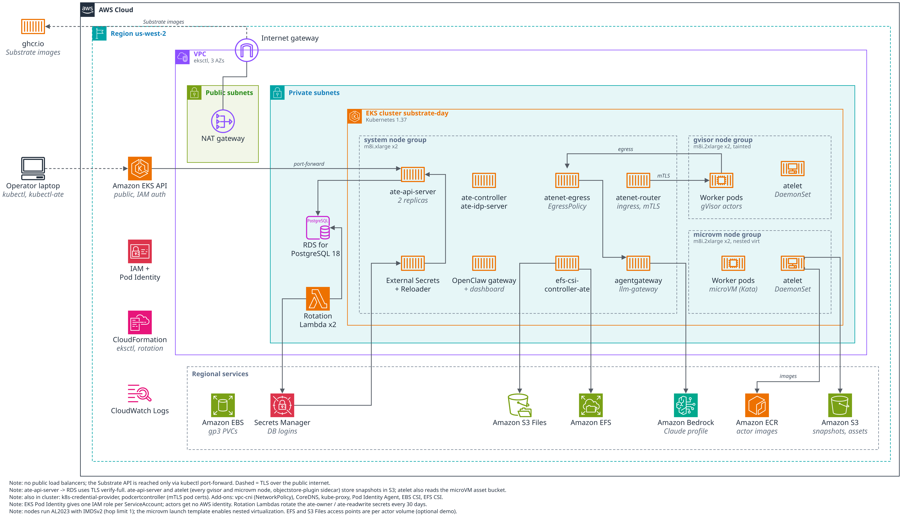
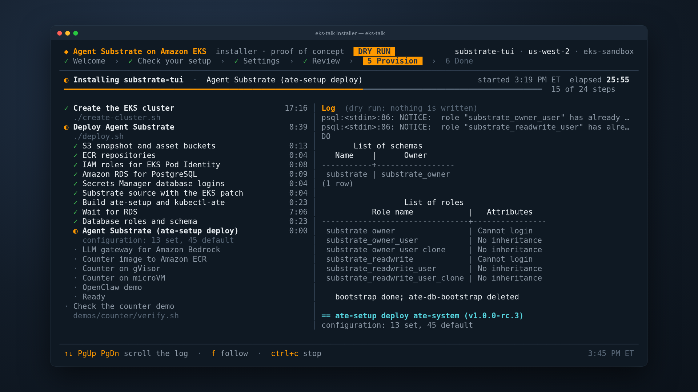

# Agent Substrate on Amazon EKS

Run [Agent Substrate](https://github.com/agent-substrate/substrate) on Amazon
EKS with the AWS services it needs: Amazon S3 for actor snapshots, Amazon RDS
for PostgreSQL for state, AWS Secrets Manager for database logins, EKS Pod
Identity for every AWS call, Amazon ECR for images, and Amazon Bedrock for
agent inference. Actors run in gVisor sandboxes and in microVMs (Kata
Containers on Cloud Hypervisor) on EC2 instances with nested virtualization.

No application is exposed: every Service is ClusterIP, the database and
buckets are private, and you reach the demos with port forwards. The
Kubernetes API endpoint is public by default (IAM authenticated); set
`EKS_PUBLIC_ACCESS_CIDRS` to your own address range.

## What you get



One EKS cluster with three node groups: `system` for the Substrate control
plane, atenet and the LLM gateway; `gvisor` for gVisor workers; `microvm` for
Kata and Cloud Hypervisor workers on EC2 with nested virtualization. EKS
Auto Mode is on as well (`AUTO_MODE=on`, the default), with its two built-in
NodePools, `general-purpose` and `system`, for any other workloads; set
`AUTO_MODE=` in `config.local.env` for a cluster without it. Around
it: Amazon S3 for actor snapshots and microVM guest assets, Amazon RDS for
PostgreSQL (TLS verify-full), Secrets Manager for the database logins, ECR
for the demo images, and Bedrock for agent inference through the in-cluster
LLM gateway. The editable diagram is
[`slides/agent-substrate-on-eks.drawio`](slides/agent-substrate-on-eks.drawio)
(open it in [draw.io](https://app.diagrams.net/)).

| Demo | What it shows |
|---|---|
| counter, gVisor and microVM | An actor counts in memory, in a file and in its root filesystem. Suspend it: the worker is freed and the snapshot goes to S3. The next request resumes it and every count continues. |
| OpenClaw always-on agent (optional) | An always-on gateway holds the chat channel (for example WhatsApp); each conversation's agent is an actor that suspends when idle and resumes on the next message. It thinks with Bedrock and holds no AWS credential. |

## Quick start: the interactive installer

The fastest way to deploy. It checks your setup, asks for the settings,
shows the commands it will run, then runs the scripts below with a live
checklist, about 30 minutes with the default choices and about an hour with every demo and plugin. Teardown is on its last screen. It runs
inside the [toolbox](#run-with-only-docker), so you need only Docker with
buildx, git, and AWS credentials for an account that meets the
[prerequisites](#prerequisites):


```bash
git clone https://github.com/csantanapr/eks-agent-substrate.git
cd eks-agent-substrate
installer/run.sh --repo . --cluster my-substrate --region us-west-2 --profile my-profile
```



Press `enter` through Welcome and Check your setup, `n` on Settings, and `y`
on Review: nothing changes in AWS before that. On the Done screen, `t` and
the cluster name tear everything down. The [installer README](installer/README.md)
shows every screen, and how to run a second cluster next to a first one.

To run the scripts yourself instead, read on.

## Prerequisites

- An AWS account in the commercial partition and credentials for the AWS CLI
  with permission to create EKS, EC2, VPC, CloudFormation, IAM, S3, RDS,
  Secrets Manager, ECR and Bedrock resources.
- Quota for the nodes: 6 instances, 40 On-Demand standard vCPUs by default
  (`m8i`), plus a NAT gateway and an Elastic IP for the new VPC.
- A region with EKS 1.37, RDS for PostgreSQL `DB_ENGINE_VERSION`, and the
  Bedrock inference profile in `BEDROCK_INFERENCE_PROFILE`, plus active
  Claude Haiku, Sonnet and Opus profiles with the same prefix. For Anthropic
  models, submit the Bedrock first-time-use form once per account.
- On your machine: `aws` (v2), `eksctl` 0.230 or newer, `kubectl`, `docker`
  with buildx (builds `linux/amd64` images; on arm64 it uses emulation),
  `go` 1.27+, `git`, `jq`, `curl`, `openssl`, `python3` with PyYAML.
- bash 4+, GNU `sed` and `sort`, and GNU `envsubst` (gettext). On macOS:
  `brew install bash gnu-sed coreutils gettext` and put the GNU tools first
  on `PATH`.

Or skip those tools: see [Run with only Docker](#run-with-only-docker).

### Run with only Docker

[`toolbox.sh`](toolbox.sh) runs any script of this repository inside a
container that has every tool above, pinned (see
[`toolbox/Dockerfile`](toolbox/Dockerfile)). The host needs only Docker
with buildx, git, and AWS credentials:

```bash
./toolbox.sh ./create-cluster.sh
./toolbox.sh ./deploy.sh
./toolbox.sh demos/counter/verify.sh
./toolbox.sh ./clean.sh && ./toolbox.sh ./delete-cluster.sh
./toolbox.sh kubectl get nodes -L ate.dev/pool     # any command
./toolbox.sh                                        # a shell with every tool
```

- The first run builds the image, in under a minute. A changed
  `toolbox/Dockerfile` builds a new one; `toolbox/pins.sh` prints the sha256
  of each download after a version change.
- The checkout is mounted at the same path and the scripts run as you, so
  `.work/` and the logs look the same as without the toolbox. Go runs with
  `GOPROXY=direct`, and its caches are in `.work/toolbox/`.
- Image builds use the host's Docker through its socket, which gives the
  container the same control of Docker that you have. `docker login` keeps
  the ECR token in `.work/toolbox/home/.docker/`.
- Credentials for `AWS_PROFILE`: when the profile uses `credential_process`
  (a helper that exists only on the host), the host's `aws` CLI exports
  short-lived credentials to a `0600` file under `.work/toolbox/creds/`
  every 2 minutes while the script runs, and deletes it on exit. Any other
  profile (SSO, static keys, assume-role) is read from `~/.aws`, mounted.
- The credential provider checkout (`CREDPROVIDER_DIR`) and `OPENCLAW_DIR`
  are mounted when they exist; add others with `TOOLBOX_MOUNTS`.
- Tested on Linux (amd64). On macOS the container runs as root, because
  Docker Desktop owns its socket.

The interactive installer runs the same way:
[`installer/run.sh`](installer/README.md#run-it-with-only-docker).

## Configure

Defaults are in `config.env`. Put your own values in `config.local.env`
(gitignored), for example:

```bash
CLUSTER_NAME=my-substrate
AWS_PROFILE=my-profile
AWS_REGION=us-west-2
TAGS="project=my-substrate team=platform"
```

### One checkout per cluster

A checkout drives one cluster: its `config.local.env` names the cluster, and
its `.work/` holds that cluster's state (kubeconfig, tools, install record).
To run a second cluster, for example to try a change while your main one
keeps running, use a second checkout with its own `config.local.env`. A git
worktree is the quickest way to get one; it shares this checkout's history
and takes seconds:

```bash
git worktree add --detach ../eks-talk-2 main   # --detach: main is checked out here already
cd ../eks-talk-2
printf 'CLUSTER_NAME=my-substrate-2\nAWS_PROFILE=my-profile\n' > config.local.env
./create-cluster.sh && ./deploy.sh
# later: ./clean.sh --yes && ./delete-cluster.sh --yes
#        cd - && git worktree remove ../eks-talk-2
```

A plain `git clone` works the same. Use a different `CLUSTER_NAME` in each:
S3 buckets, IAM roles, the RDS instance and the ECR repositories are all
named from it. Two checkouts on one host must not run
`demos/counter/verify.sh` at the same time: both use local ports 8001 and
8002.

## Deploy

```bash
./create-cluster.sh   # EKS cluster with eksctl, about 20 minutes
./deploy.sh           # AWS resources, Agent Substrate and the demos, about 25 minutes
```

Both are idempotent: run them again after a change or a failure.
`create-cluster.sh` adds node groups or add-ons a failed first run left out;
it does not change ones that exist (use eksctl for that).

## Try it

```bash
export KUBECONFIG=$PWD/.work/kubeconfig PATH=$PWD/.work/bin:$PATH
kubectl ate get actors -A
demos/counter/verify.sh          # suspend and resume on gVisor and on microVM
```

`verify.sh` also waits for each snapshot's copy in S3, about 5 minutes per
actor. `--quick` skips that wait, and the installer uses it.

By hand:

```bash
kubectl ate create actor my-counter -a ate-demo-counter --template counter
kubectl ate proxy actor my-counter -a ate-demo-counter 8001:80 &
curl -s localhost:8001
kubectl ate suspend actor my-counter -a ate-demo-counter
curl -s localhost:8001          # resumes the actor; the counts continue
```

The OpenClaw demo needs a checkout of the always-on-agent repository with its
EKS scripts: set `OPENCLAW_DIR`, or `OPENCLAW_REPO` and `OPENCLAW_REF`, and
optionally `WHATSAPP_PEER`. The gateway keeps its state on EFS, which every
Availability Zone can mount, so run `demos/efs/deploy.sh` first, then
`demos/openclaw/deploy.sh` and `demos/openclaw/deploy.sh verify`.

## EKS Auto Mode

With `AUTO_MODE=on` (the default), the cluster runs EKS Auto Mode next to
the three node groups, with its two built-in NodePools, `general-purpose` and
`system`. The node groups only take the pods meant for them: `gvisor` and
`microvm` the worker pods, `system` the Substrate control plane (pinned by
`ate-setup --cordon-system-infra-components`) and this repository's system
pods. The `system` group carries the taint
`ate.dev/workloadType=ate-system-infra:NoSchedule`, which those pods
tolerate. Every other pod, with no nodeSelector or toleration, runs on a
node Auto Mode launches for it:

```bash
kubectl run hello --image=public.ecr.aws/docker/library/busybox --restart=Never -- sh -c 'echo hello; sleep 600'
kubectl get pod hello -o wide          # on a new node
kubectl get nodes -L karpenter.sh/nodepool,eks.amazonaws.com/compute-type
kubectl delete pod hello               # Auto Mode removes the empty node
```

The OpenClaw gateway and dashboard have no node selector, so they run on
Auto Mode nodes too. Auto Mode nodes enforce NetworkPolicy, use IMDSv2 with
hop limit 1 and run in the private subnets. The built-in NodePools cannot
carry your tags, so `create-cluster.sh` and `deploy.sh` add `TAGS` to the
Auto Mode instances, volumes and network interfaces they find; a node Auto
Mode launches later starts with EKS tags only. Set `AUTO_MODE=` in
`config.local.env` for a cluster without Auto Mode, before
`create-cluster.sh`: the mode is fixed when the cluster is created.

## Optional: per-actor volumes on Amazon EFS and Amazon S3 Files

Substrate's external volumes (CSI, `ExternalVolumes` preview) work with the
Amazon EFS CSI driver, for both EFS and S3 Files. Each actor gets its own
access point when it is first resumed. That access point is mounted on
whichever node the actor resumes on, and deleted with the actor. With S3
Files, the actor's files also appear as objects in an S3 bucket, about a
minute after they are written.

```bash
demos/efs/deploy.sh                       # EFS, the driver add-on, Substrate's CSI controller
demos/efs/verify.sh                       # gVisor and microVM: data survives suspend and resume
demos/efs/verify-move.sh                  # the actor resumes on another node and finds its files
demos/s3files/deploy.sh                   # S3 Files on top (needs demos/efs/deploy.sh)
STORAGE=s3files demos/efs/verify.sh
```

`clean.sh` removes both. How the pieces fit:

| Piece | What it does |
|---|---|
| `aws-efs-csi-driver` EKS add-on | Its node plugin mounts each volume (TLS, through `efs-proxy`). The add-on config also mounts `/var/lib/ate` with bidirectional propagation, so atelet sees the mount. |
| `efs-csi-controller-ate` | A second controller from the same image, for Substrate. ate-api-server calls `CreateVolume` itself over gRPC, so the driver's socket is fronted by Envoy with mTLS: a Substrate servicedns certificate, and only ate-api-server's SPIFFE ID allowed. |
| `CSIDriverConfig` + StorageClass | `provisioningMode: efs-ap` or `s3files-ap`, one access point per actor under `/ate` |
| IAM (Pod Identity) | The controllers may create and delete tagged access points on this file system only. For S3 Files, the node plugin may mount this file system only. |

Things to know:
- Set `EFS_UID`/`EFS_GID` to the user the actor runs as. Actors run without
  `CAP_DAC_OVERRIDE`, so even root can't write an access point directory
  that another uid owns.
- With S3 Files, an actor that runs as root also needs
  `s3files:ClientRootAccess` (the script grants it only when `EFS_UID=0`). A
  non-root image is better.
- Turning on the preview reinstalls Substrate, and that rolls the worker
  pods: actors running at the time end up `CRASHED`. Restore one with
  `kubectl ate revert actor NAME -a ATESPACE`; `demos/counter/verify.sh`
  reverts its own. Later installs keep the preview gates the cluster runs.
- Deleting an actor deletes its access point but keeps the files under it
  (the driver's default, `--delete-access-point-root-dir=false`).
  `clean.sh` deletes the file systems and the bucket.
- The template's golden snapshot gets a volume of its own too, so each
  template leaves one extra directory under `/ate`.

## Optional: rotate the database logins

Secrets Manager rotates the owner and readwrite logins, and ate-api-server
follows with a rolling restart. ate-api-server reads both connection strings
only at start, and the owner login runs outbox maintenance every minute, so
both logins rotate.

```bash
demos/db-rotation/deploy.sh               # rotation functions, External Secrets, ESO Reloader
demos/db-rotation/verify.sh               # rotate both now; check the sync, the rollout and the API
```

`clean.sh` removes it. How the pieces fit:

| Piece | What it does |
|---|---|
| Rotation function | The AWS-hosted `PostgreSQLMultiUser` Lambda (`rotation.cfn.yaml`), in the private subnets with its own security group, every 30 days. It alternates each login between `USER` and `USER_clone`, so the login the running pods hold keeps working during the rollout. Native RDS rotation covers only the master user. |
| External Secrets Operator | Controller only (no webhook, nothing listening), with a Pod Identity role that may read the two login secrets. Every minute it writes both connection strings into `ate-api-server-secret-envvars`. |
| ESO Reloader | A `Config` that rolls the ate-api-server Deployment when that Secret changes. Nothing changes in the Substrate manifests. |

Things to know:
- `aws/db-bootstrap.sh` creates both users of each login, `NOINHERIT` and
  granted the Substrate role, before the first rotation. Otherwise the
  rotation function creates the clone with `INHERIT`, and the next
  `./deploy.sh` fails in `setup.sql`.
- A rotation takes about 10 seconds, and the restart follows within the
  1 minute refresh.

## Optional: inject Secrets Manager secrets into actor requests

An actor sends an API request with a placeholder header, and the egress
gateway swaps in a secret from AWS Secrets Manager on the way out. The actor
never holds the secret, so it is not in its memory, files or snapshots. The
[credprovider-aws-secret-manager](https://github.com/csantanapr/credprovider-aws-secret-manager)
plugin reads the secret for the gateway
([egress credential injection](https://github.com/agent-substrate/substrate/blob/main/docs/guides/egress-credential-injection.md)).
[`egress-policy.example.yaml`](demos/credprovider-aws/egress-policy.example.yaml)
is the EgressPolicy the demo gives its actor, with a placeholder account.

```bash
git clone https://github.com/csantanapr/credprovider-aws-secret-manager ~/credprovider-aws-secret-manager
demos/credprovider-aws/deploy.sh          # provider, IAM, secrets, gateway, probe actors; set CREDPROVIDER_DIR for another checkout
demos/credprovider-aws/verify.sh          # injection, no value in the actor, 403s, logs
```

`clean.sh` removes it. How the pieces fit:

| Piece | What it does |
|---|---|
| `aws-sm-credential-provider` | Two replicas in `ate-system`, built with docker from your checkout and pushed to ECR. It serves mTLS with a Substrate servicedns certificate, accepts only atenet-egress's SPIFFE ID, and its NetworkPolicy admits only atenet-egress. |
| Secret policy | A ConfigMap: actors in `ate-demo-credprovider` may resolve `ate/ate-demo-credprovider/*`. Every other atespace, such as `ate-demo-credprovider-denied`, gets a 403. |
| IAM (Pod Identity) | The provider may call `GetSecretValue` only on secrets under `ate/` tagged `ate.dev/injectable=true` and with this deployment's owner tag. The demo's `untagged-token` lacks the first tag, so IAM refuses it. |
| Egress gateway | `deploy.sh` writes `.work/credential-providers/secretsmanager.amazonaws.com.json` and reinstalls Substrate. `substrate/install.sh` adds every file there to `--credential-provider`, so atenet-egress serves `k8s.io` and `secretsmanager.amazonaws.com`, and every later `./deploy.sh` keeps it that way. |
| Probe actors | Substrate's e2e probe, from the release source, on a gVisor pool. Its EgressPolicy has an `https` rule for the echo endpoint that replaces `Authorization` with `ate-secret://secretsmanager.amazonaws.com/accounts/<account>/regions/<region>/secrets/ate/ate-demo-credprovider/demo-token/stages/AWSCURRENT`. |

Things to know:
- `verify.sh` sends the request to a public header-echo endpoint,
  `https://postman-echo.com/headers` by default (`CREDPROVIDER_ECHO_URL`), and
  compares the echoed value with Secrets Manager's by SHA-256. The echo sends
  the value back to the actor in its response; a real API does not.
- The provider caches a value for 30 seconds, so after a rotation the old
  value is injected for up to 30 seconds.
- The secret names (`ate/ate-demo-credprovider/...`) carry no cluster name:
  one deployment per account and Region can run this demo. `deploy.sh` stops
  if another deployment owns them.
- Registering the provider reinstalls Substrate with the preview gates the
  cluster runs (for example `ExternalVolumes` from `demos/efs`).

## Optional, preview: mode 3, gVisor inside a microVM Pod

A proposal for upstream, in the `microvm-mode-3` branch of
[csantanapr/substrate](https://github.com/csantanapr/substrate/tree/microvm-mode-3).
`MODE3_COMMIT` is on `microvm-mode-3-mixed`, which adds three fixes on top:
atelet picks the transport per worker, so gVisor and microVM pools keep working
on a cluster that also runs mode 3; staging keeps the sticky bit of an image's
`/tmp`; and a mode 3 worker keeps its actors on a tmpfs in the guest, since
overlayfs refuses Kata's virtio-fs share for an actor's root filesystem. That
tmpfs is guest memory, so the mode 3 pool gets 2 GiB per worker.
The worker Pod is itself a microVM, and the worker runs actors with gVisor
inside it. An escape from gVisor then lands in the microVM's guest kernel, not
on the node or in other Pods. It is not part of a Substrate release.

```bash
echo MODE3=on >> config.local.env
./deploy.sh                     # Substrate from the proposal
demos/mode3/deploy.sh           # Kata on the microvm nodes, a counter pool on mode 3
demos/counter/verify.sh         # also runs a round trip on mode 3
```

Or choose "Mode 3" under Plugins in the installer. `clean.sh` removes it. How
the pieces fit:

| Piece | What it does |
|---|---|
| Substrate | `MODE3=on` installs commit `MODE3_COMMIT` of the fork, with its images from `ghcr.io/csantanapr/substrate` (built by `.github/workflows/mode3-images.yaml`) and the `NetworkWorkers` preview gate. The EKS patch applies to it as is. |
| Kata Containers | kata-deploy 3.32.0, Kata's own installer, on the microvm node group only, which already has `/dev/kvm` through nested virtualization. Only the Go runtime with Cloud Hypervisor, the VMM `ateworker-microvm` uses too, behind RuntimeClass `kata`. |
| WorkerPool | The gVisor class with `spec.networkTransport.runtimeClassName: kata`: the controller runs the worker Pods under Kata, and atelet reaches them over mutual TLS on the Pod network (port 8087, the `atelet-workers` Service) instead of the node's shared files and Unix sockets. Snapshots and sandbox assets go through a staging service. |
| Check | `demos/counter/verify.sh` checks that every worker Pod of the pool runs under RuntimeClass `kata`, then suspends and resumes the counter on it. |

## Optional: mode 3 on isolated sandboxes

EKS Auto Mode ships RuntimeClass `isolated-sandbox`, which runs each Pod in its
own sandbox with its own guest kernel. A Pending Pod that asks for it makes
Auto Mode's Karpenter launch a node that can run it, so this needs
`AUTO_MODE=on`; it does not work on node groups. It also needs `MODE3=on`,
since the worker Pods run gVisor actors over the Pod network as in mode 3.

```bash
printf 'MODE3=on\nMODE3_ISO=on\n' >> config.local.env
./deploy.sh
demos/mode3/deploy.sh           # the Kata pool, which verify.sh checks too
demos/mode3-iso/deploy.sh       # NodePool, atelet-iso, a counter pool on isolated-sandbox
demos/counter/verify.sh         # also runs a round trip on the isolated pool
```

Or choose "Mode 3 on isolated sandboxes" under Plugins in the installer, which
turns on Mode 3 and Auto Mode too. `clean.sh` removes it.

| Piece | What it does |
|---|---|
| NodePool | `ate-isolated`, a copy of `general-purpose` that labels its nodes `ate.dev/pool=isolated` and taints them `ate.dev/sandboxClass=isolated:NoSchedule`, so only the worker Pods land there. |
| atelet-iso | A copy of the atelet DaemonSet for those nodes. They run Bottlerocket, so it mounts the ECR credential provider from `/usr/libexec/kubernetes/kubelet/plugins` and its own provider config without `AWS_PROFILE`. |
| WorkerPool | `counter-iso` in `ate-demo-counter-iso`, with `networkTransport.runtimeClassName: isolated-sandbox` and 2 GiB per worker. It turns off the sandbox's default network and disk throttles with `sandbox.amazonaws.com/*` annotations, since resume times out with them on. |
| Check | `demos/counter/verify.sh` checks that every worker Pod runs under `isolated-sandbox`, then suspends, resumes and deletes a counter on it. |

## Move to a new release

Set `SUBSTRATE_TAG` in `config.local.env` (for example `v1.0.1`, or
`latest` for the newest tag), or pass it for one run, then reinstall on the
same cluster:

```bash
./clean.sh                                # removes the installed release
SUBSTRATE_TAG=v1.0.1 ./deploy.sh     # installs the new one
```

`clean.sh` removes the release the cluster runs (it records the tag at install
time), whatever the config says now. The worker images are pinned to the
digest the new tag names. If `patches/` has no patch for the new tag, the
newest patch that applies cleanly is used with a warning, and `deploy.sh`
stops if none does (see `patches/README.md`). A clean apply only means the
text still fits: check the install, then save the patch under the new tag. Keep the cluster: `delete-cluster.sh` is only needed
to change the node groups or the Kubernetes version.

## Tear down

```bash
./clean.sh            # everything deploy.sh created; the cluster stays
./delete-cluster.sh   # the EKS cluster, its VPC and the launch template
```

Both ask you to type the cluster name; pass `--yes` to skip that.
`clean.sh` deletes the RDS instance without a final snapshot and empties the
S3 buckets. It ends by running `aws/inventory.sh`, which lists anything left
and fails if there is; `delete-cluster.sh` runs it first and refuses to start
until `clean.sh` has finished. Run `aws/inventory.sh --all` any time.

## How it is built, and why

| Area | Choice |
|---|---|
| Nodes | Amazon Linux 2023 EKS-optimized AMI, IMDSv2 only with a hop limit of 1, so pods in their own network namespace cannot read node credentials from IMDS. Host-network pods (CNI, kube-proxy, CSI) still can, so keep host networking to trusted system DaemonSets. AWS access is only through Pod Identity. |
| microVM nodes | Nested virtualization through the launch template's `CpuOptions`, on Intel 7th and 8th generation families (m8i here; `create-cluster.sh` checks the type). No bare metal needed. |
| Network | VPC CNI with NetworkPolicy enforcement on: Substrate ships default-deny policies. Actors have no external egress except what their EgressPolicy allows. |
| Identity | One IAM role per ServiceAccount through EKS Pod Identity, scoped to its buckets, repositories or model. Actors get no AWS identity. |
| S3 | Block Public Access, BucketOwnerEnforced, default encryption, a TLS-only bucket policy, a lifecycle rule for incomplete uploads. A separate read-only bucket for microVM guest assets. |
| RDS | Private subnets, port 5432 open only to the cluster security group, TLS verify-full, separate owner (migrations) and readwrite (runtime) logins in Secrets Manager, master password managed by RDS. |
| Bedrock | An in-cluster agentgateway signs requests with its Pod Identity role, which may invoke only the inference profiles it serves: `claude` (the default) and the newest `claude-haiku`, `claude-sonnet` and `claude-opus`. Each actor's EgressPolicy allows only the gateway and swaps a placeholder token for a signed actor JWT. |

For production, also: Multi-AZ RDS with longer backup retention and deletion
protection (`DB_MULTI_AZ`, `DB_BACKUP_DAYS`, `DB_DELETION_PROTECTION`), a
CIDR-restricted EKS API endpoint (`EKS_PUBLIC_ACCESS_CIDRS`), and
`--ateapi-authz-bootstrap-owners` set to your operators instead of the shared
client identity (pass it through `substrate/install.sh`).

## Known limits

- Resource names derive from `CLUSTER_NAME` and the region. Global names (S3
  buckets, IAM roles) also carry the region, and the scripts only reuse or
  delete them when they have the owner tag
  `agent-substrate-on-eks/deployment=<cluster>.<region>`.
- S3 bucket names are deterministic. Once deleted, a name can in principle be
  taken by another account before the next deploy; `deploy.sh` then stops.
- The OpenClaw demo puts one gateway token in its ActorTemplate, so every
  actor and its snapshots hold it. It is a demo credential with no AWS access;
  a production integration would mint a per-actor credential at resume.
- Tested on the commercial AWS partition (`aws`) in us-west-2.

## Layout

| Path | What |
|---|---|
| `create-cluster.sh`, `deploy.sh`, `clean.sh`, `delete-cluster.sh` | The four entry points |
| `config.env` | Settings; overrides go in `config.local.env` |
| `lib/common.sh` | Shared helpers: config, naming, tags, kubeconfig |
| `aws/` | S3, ECR, IAM, RDS, Secrets Manager; the database bootstrap; `inventory.sh` |
| `substrate/` | Fetch, patch and build the installer; install Agent Substrate |
| `patches/` | The installer patch for EKS and S3, and why |
| `llm-gateway/` | agentgateway with the Bedrock backend |
| `demos/` | The counter and OpenClaw demos; per-actor EFS and S3 Files volumes; DB login rotation; Secrets Manager credential injection; mode 3 (preview) |
| `.github/` | Workflows that build the mode 3 images to GHCR |
| `slides/` | The talk deck (open `slides/index.html`) |
| `installer/` | Interactive terminal installer over the scripts |
| `.agents/skills/` | Agent skill for deploying and troubleshooting this repo; `.claude/skills` and `.kiro/skills` link to it |
| `.work/` | Generated: kubeconfig, Substrate clone, tools (gitignored) |
