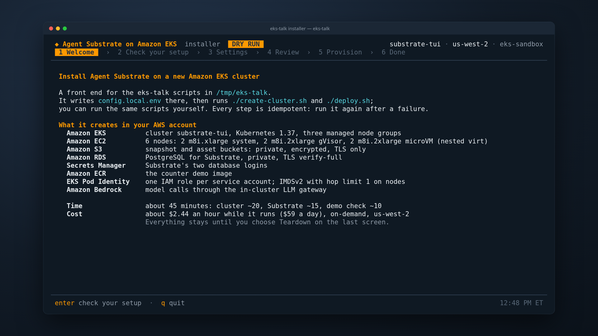
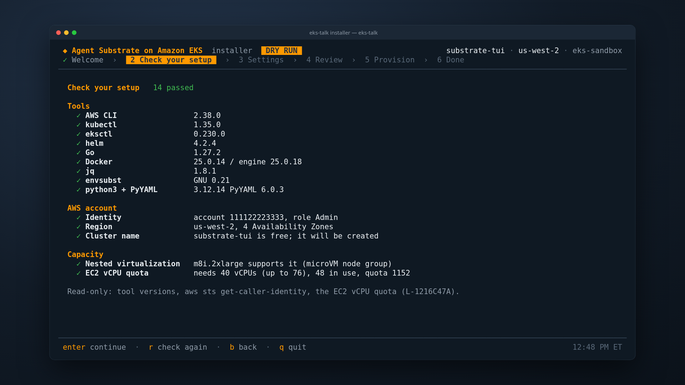
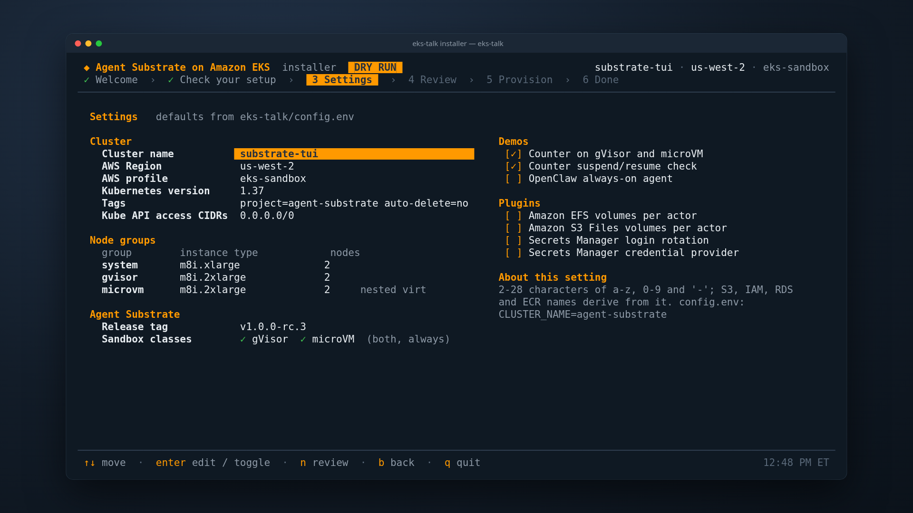
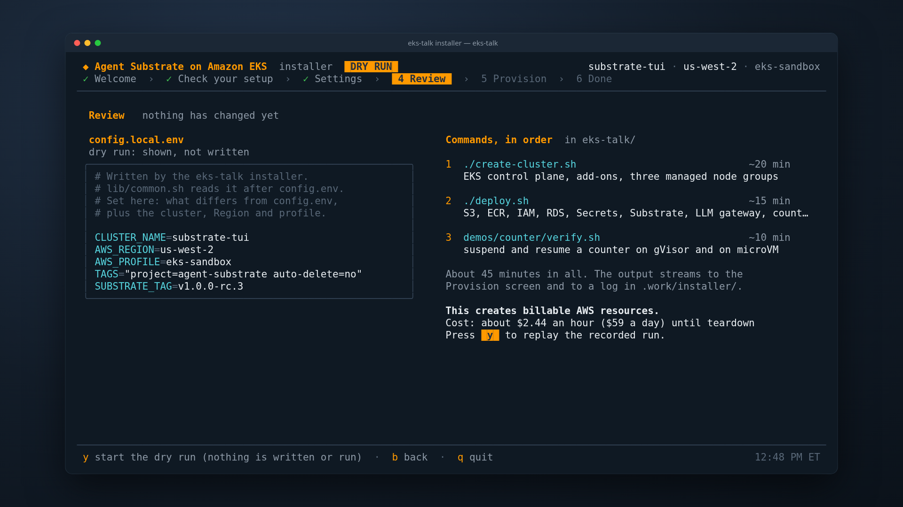
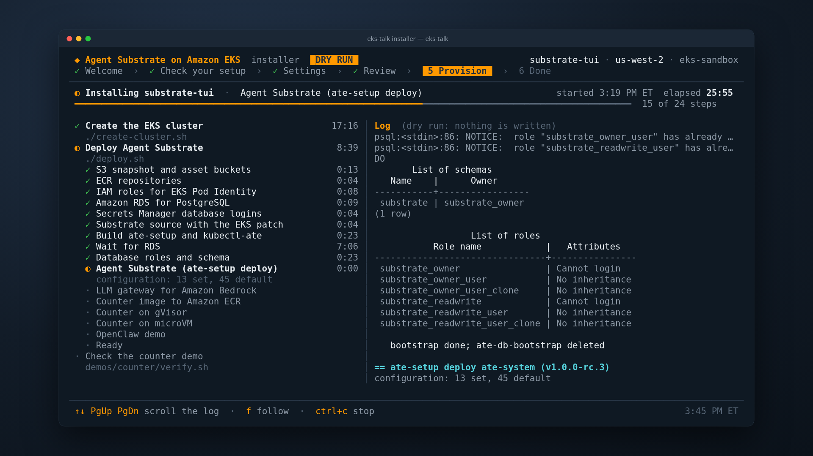
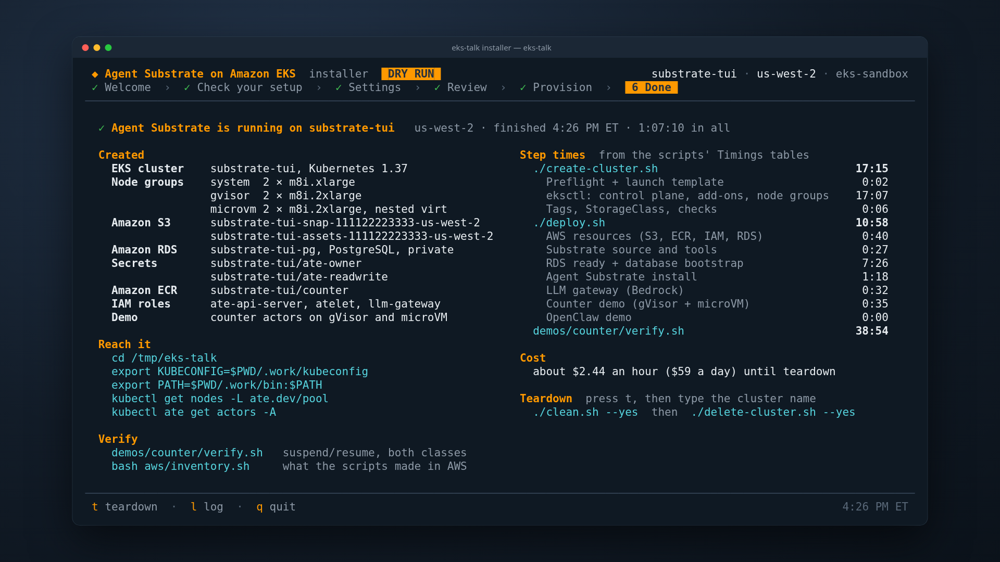

# installer/: the interactive installer

A full-screen terminal front end for this repository's scripts, written in
Go with [Bubble Tea](https://github.com/charmbracelet/bubbletea),
[Bubbles](https://github.com/charmbracelet/bubbles) and
[Lip Gloss](https://github.com/charmbracelet/lipgloss). It asks the
questions, writes `config.local.env`, runs the scripts and shows their
progress.

It is the fastest way to deploy (the top-level README's Quick start). It
adds no install logic of its own: it runs `./create-cluster.sh`,
`./deploy.sh` and the demo checks in the checkout you point it at, so
everything it does can also be done by running those scripts yourself.

## Screens

| # | Screen | What happens |
|---|---|---|
| 1 | Welcome | What it creates (EKS, node groups, S3, RDS, Secrets Manager, ECR, Pod Identity, Bedrock), about 45 minutes, a rough hourly cost |
| 2 | Check your setup | aws, kubectl, eksctl, helm, go, docker, jq, envsubst and PyYAML with versions; `aws sts get-caller-identity` (account and role); the Region; whether the cluster name is free; nested virtualization on the microVM instance type; the EC2 vCPU quota (L-1216C47A) against what the node groups need. All read-only |
| 3 | Settings | Cluster name, Region, profile, Kubernetes version, tags, Kube API access CIDRs, instance type and count per node group, the Substrate release tag, then two lists of choices: Demos (counter check, OpenClaw always-on agent) and Plugins (EFS volumes, S3 Files volumes, login rotation, Secrets Manager credential provider). OpenClaw clones always-on-agent (branch eks) into `.work/` unless `OPENCLAW_DIR` names a checkout; the credential provider is offered when its checkout is at `CREDPROVIDER_DIR` (default `~/credprovider-aws-secret-manager`). Defaults come from the checkout's `config.env` (then its `config.local.env`); the help panel shows the comment above each key in `config.env` |
| 4 | Review | The exact `config.local.env` it will write, and the commands it will run, in order. Nothing has changed until you press `y` |
| 5 | Provision | Runs `./create-cluster.sh`, `./deploy.sh` and the chosen demos and plugins. A live checklist per script, built from the scripts' own `== <step>` lines (`log()` in `lib/common.sh`) and the Timings table each prints at exit; a scrollable log pane; elapsed time; on a failure, the failing step and the log path, and `r` to run again (the scripts are idempotent) |
| 6 | Done | What was created, how to reach it (`.work/kubeconfig`, `kubectl ate`), verify commands, the step times, and Teardown: `t`, then type the cluster name, runs `./clean.sh --yes` and `./delete-cluster.sh --yes`. The teardown shows on the Provision screen, with steps 5 and 6 named Teardown and Removed; `q` quits when it ends |

### 1. Welcome



### 2. Check your setup



### 3. Settings



### 4. Review



### 5. Provision



### 6. Done



## Install a second cluster, step by step

This is how the `substrate-tui` cluster was made, and how to make it again.
It uses a second checkout, so the main checkout's `config.local.env`,
`.work/` and cluster are not touched.

1. From the main checkout, add a second checkout next to it. `--detach` is
   needed because `main` is already checked out in the first one.

   ```bash
   cd /path/to/eks-talk
   git worktree add --detach ../eks-talk-tui main
   ```

2. Build the installer.

   ```bash
   cd installer
   GOTOOLCHAIN=local go build -o installer .
   ```

3. Run it against the second checkout. `--profile` is your AWS CLI profile.

   ```bash
   ./installer --repo ../../eks-talk-tui --cluster substrate-tui --region us-west-2 --profile eks-sandbox
   ```

4. In the installer:
   - **Welcome:** `enter`.
   - **Check your setup:** every row should be green. Fix what is not
     (a missing tool, an expired AWS session, the vCPU quota), press `r`
     to check again, then `enter`.
   - **Settings:** keep the defaults or change them (`↑↓`, `enter` to
     edit), then `n`.
   - **Review:** read the `config.local.env` it will write and the commands
     it will run, then `y`. Nothing in AWS changes before this.
   - **Provision:** about 30 minutes for the cluster and the deploy, then the
     counter check (about 10 minutes). On a failure, read the step it names,
     fix it, and press `r`; the scripts pick up where they stopped.
   - **Done:** `export KUBECONFIG=../../eks-talk-tui/.work/kubeconfig` and the
     verify commands it prints. `q` quits.

5. Tear it down when you are done, either from the installer:

   ```bash
   ./installer --repo ../../eks-talk-tui --done    # then t, and type substrate-tui
   ```

   or with the scripts in that checkout:

   ```bash
   cd ../../eks-talk-tui && ./clean.sh --yes && ./delete-cluster.sh --yes
   ```

   Then remove the second checkout from the main one:
   `git worktree remove ../eks-talk-tui`.

Two checkouts on one host must not run `demos/counter/verify.sh` at the same
time: both use local ports 127.0.0.1:8001 and 8002.

## Run it with only Docker

[`run.sh`](run.sh) builds the installer inside the toolbox
([Run with only Docker](../README.md#run-with-only-docker)) and starts it
there, so the host needs no Go, and the Check screen sees the toolbox's
tools. It takes the installer's flags, mounts the `--repo` checkout, and
passes credentials for `--profile`. From the main checkout:

```bash
cd /path/to/eks-talk
git worktree add --detach ../eks-talk-tui main
installer/run.sh --repo ../eks-talk-tui --cluster substrate-tui --region us-west-2 --profile eks-sandbox
```

The screens and keys are the same, Teardown included. Run the commands the
Done screen prints through that checkout's own toolbox:

```bash
cd ../eks-talk-tui
./toolbox.sh kubectl --kubeconfig .work/kubeconfig get nodes -L ate.dev/pool
```

## Build and run

Go 1.27 or newer, and everything the scripts need (the Check screen lists it).

```bash
cd installer
GOTOOLCHAIN=local go build -o installer .
./installer --repo ..                      # install from this checkout
./installer --repo /path/to/other-checkout --cluster my-cluster --profile my-profile
```

`--repo DIR` is the eks-talk checkout to install from (default: the current
directory, or its parent when run from `installer/`). The installer writes
`config.local.env` in that directory only, and its state stays in that
directory's `.work/`, so a second checkout drives a second cluster.

| Flag | Default | Meaning |
|---|---|---|
| `--repo DIR` | `.` or `..` | the checkout to install from |
| `--cluster`, `--region`, `--profile` | the checkout's config | starting values for `CLUSTER_NAME`, `AWS_REGION`, `AWS_PROFILE` |
| `--dry-run` | off | replay a recorded run through the same screens; nothing is written or run |
| `--record FILE` | built in | the record `--dry-run` replays (default `testdata/install.jsonl`) |
| `--speed N` | 60 | `--dry-run` replays N times faster (long gaps are capped at 1.5 s) |
| `--auto` | off | walk the screens on their own; with `--dry-run`, a hands-off demo that quits at Done. It never starts a teardown |
| `--done` | off | open on the Done screen of the checkout's last install (read from `.work/installer/`), with its summary and Teardown |
| `--redact` | off | replace the AWS account id with `111122223333` on screen and in snapshots |
| `--snapshot-size WxH` | `126x33` | the size snapshots are drawn at |
| `--html DIR` | | rewrite `NAME.html` from every `NAME.ansi` in DIR, then exit |

Keys: `enter` next, `b` back, `q` quit, `s` save a snapshot of the current
screen; on Settings `↑↓` move, `enter` edit or toggle, `n` review; on
Provision `↑↓ PgUp PgDn` scroll the log, `f` follow, `ctrl+c` twice stops
the run.

### What it writes

| Path (in `--repo`) | What |
|---|---|
| `config.local.env` | the settings that differ from `config.env`, plus the cluster, Region and profile, and any other keys the previous file had (mode 0600) |
| `.work/installer/config.local.env.bak-<time>` | the previous `config.local.env`, when it was different |
| `.work/installer/install-<time>.log` | the plain output of every script |
| `.work/installer/install-<time>.jsonl` | the same run as timed events, which `--dry-run --record` replays |

## Dry run

```bash
cd installer
go run . --dry-run              # the live install of substrate-tui, about a minute
go run . --dry-run --auto       # the same, hands off
```

`testdata/install.jsonl` is the record of the live run that created the
`substrate-tui` cluster on 2026-11-05, with the account id replaced by
`111122223333` and three unused cloud-specific lines of ate-setup's
settings dump left out. In that run the counter check was held for 28 minutes before
it started, so that it would not share 127.0.0.1:8001 and 8002 with another
checkout's counter check on the same host; its 38:54 on the Done screen
includes the hold (the check itself took about 10 minutes).

To come back to a finished install later (its summary, or Teardown):

```bash
./installer --repo /path/to/checkout --done
```

## Screenshots

```bash
INSTALLER_SNAPSHOT_DIR=/tmp/shots go run . --dry-run --auto --redact
node docs/render.mjs /tmp/shots docs 01-welcome=welcome 02-check=check \
  03-settings=settings 04-review=review 05-provision-016=provision 06-done=done
```

With `INSTALLER_SNAPSHOT_DIR` set, the installer writes each screen as it
first shows it (`01-welcome`, `02-check`, `03-settings`, `04-review`, one
`05-provision-NNN` per checklist step, `06-done`, and `snap-NN-*` for each
`s`), as `NAME.ansi` and as `NAME.html`: a 1920x1080 page with the screen in
a terminal window. `docs/render.mjs` turns the pages into PNGs with headless
Chromium (Playwright from the talk-video-record skill). The PNGs in `docs/`
come from the command above: a `--dry-run` replay of the live install of
`substrate-tui`, with the account id and local paths replaced. They are shown
under [Screens](#screens).

## Tests

```bash
cd installer
go vet ./... && test -z "$(gofmt -l .)" && go test ./...
```

- `internal/config`: parsing `config.env` (and this repository's own),
  writing `config.local.env`, a round trip through bash, validation.
- `internal/plan`: `== <step>` lines to checklist rows (fresh run, rerun,
  steps the plan does not list, failure), the Timings table, and a check
  that every planned row matches a `log "..."` line the scripts really print,
  so rewording a step fails the test instead of stalling a row.
- `internal/run`: running scripts in order, stopping at the first failure,
  the record and the plain log; replay.
- `internal/ui`: the recorded live run replayed through every screen, with
  every screen exactly 126 x 33 cells; settings editing and validation.
- `internal/preflight`, `internal/snap`: version parsing, the vCPU quota
  math, ANSI to HTML.

## Code

| Path | What |
|---|---|
| `main.go` | flags, `--dry-run` setup, the Bubble Tea program |
| `internal/config` | `config.env` / `config.local.env` parsing, rendering, writing, validation |
| `internal/preflight` | the Check screen's read-only checks |
| `internal/plan` | the commands per choice, their expected checklist rows, and the checklist state |
| `internal/run` | runs the scripts (bash, own process group, stdin closed) or replays a record |
| `internal/ui` | the screens |
| `internal/snap` | snapshots: ANSI and HTML |
| `docs/render.mjs` | HTML snapshots to PNG |

## Modules

Versions are pinned in `go.mod`: bubbletea v1.3.10, bubbles v0.21.1,
lipgloss v1.1.0. The module proxy and the checksum database were not
reachable from the build host, so the modules were fetched straight from
their repositories (`GOPROXY=direct GOSUMDB=off`): **`go.sum` was not checked
against the Go checksum database.** Run `go mod verify` on a host that can
reach it before relying on these hashes.

## Not done yet

- New clusters, or a cluster these scripts made, only: no cluster picker.
- Both sandbox classes (gVisor and microVM) are always installed, and
  `deploy.sh` always deploys the counter demo: the scripts have no switch
  for either yet. The ingress SPIFFE IDs are not asked.
- The cost estimate knows m8i on-demand prices in us-west-2 only.
- `demos/counter/verify.sh` binds 127.0.0.1:8001 and 8002, so two checkouts
  on one host must not run it at the same time; the installer does not
  check for that yet.
- No upgrade track, no one-line web launcher, Linux and macOS only.
