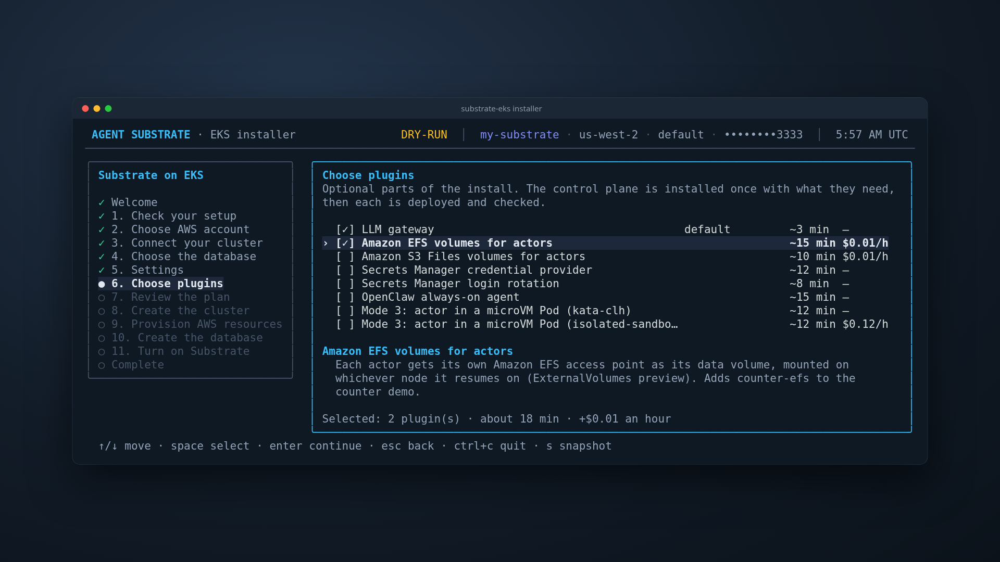
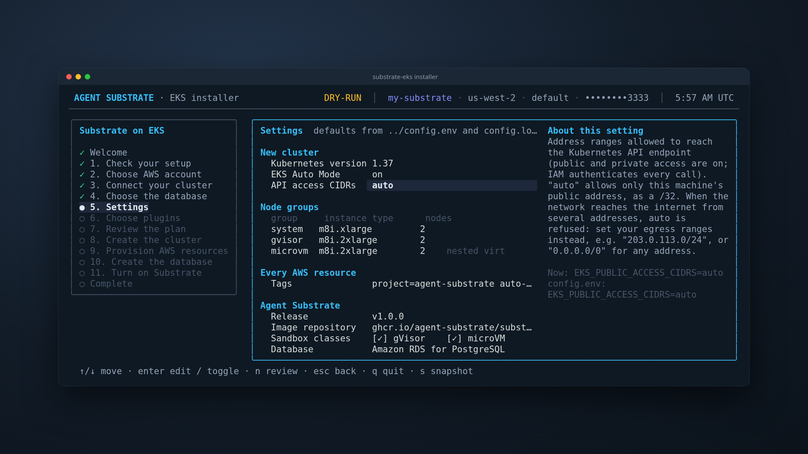
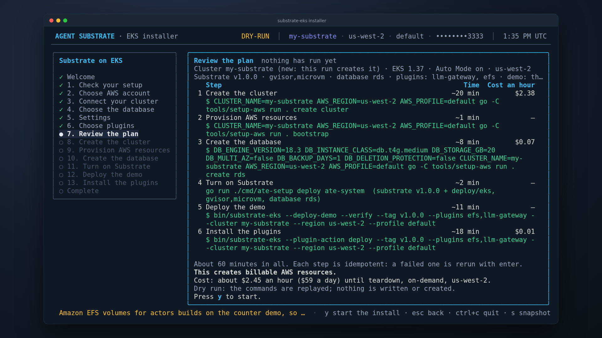
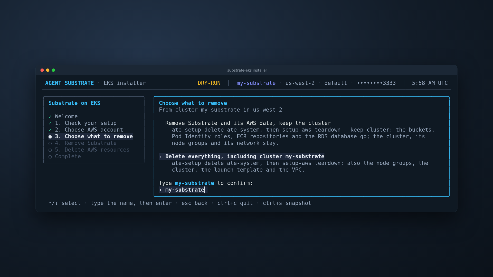
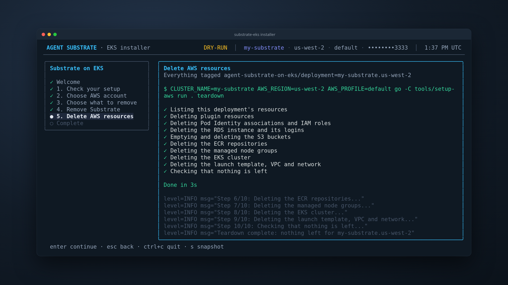

# substrate-eks: native installer

A Go installer for Agent Substrate on Amazon EKS. It follows the architecture
of [ai-on-gke/substrate-gke](https://github.com/ai-on-gke/substrate-gke)
package for package: a Bubble Tea wizard over Go provisioning code. It calls
AWS through the AWS SDK for Go v2 and installs the control plane with
upstream's `ate-setup`. No install step runs a shell script or `bash -c`.

## What it creates

The wizard runs these steps in order. Each one is idempotent: a rerun creates
nothing that already exists, and a run that stopped part way is completed.
When your AWS session ends in the middle of a step, the setup-aws steps wait,
for up to 30 minutes, for you to refresh the profile's credentials, then go
on; refreshed credentials for another account or role stop them. So do the
AWS SDK calls the installer makes while it installs the database schema, the
demo and the plugins. The rest do not wait and fail at once on an expired
session: the installer's quick reads of the cluster (the wizard's cluster
list, the describe at the start of a step), kubectl's token (`aws eks
get-token`), `ate-setup` and the `aws` CLI commands it runs. Refresh the
credentials and press enter in the wizard (or run the command again) to
rerun the failed step.

| Step | Command | What it creates |
|---|---|---|
| Cluster | `setup-aws create cluster` | A VPC with public and private subnets across two or more Availability Zones and a NAT gateway. The cluster and node IAM roles. An EKS cluster (Auto Mode by default, standard optional) whose public endpoint accepts only `EKS_PUBLIC_ACCESS_CIDRS` (default `auto`: this machine's public address as a /32 on a new cluster, refused when the network reaches the internet from several addresses; then set the variable to your egress ranges, or to `0.0.0.0/0`, since IAM still authenticates every call; an existing cluster keeps its ranges unless the variable is set), checked by connecting to the endpoint once the cluster is active, with an access entry for you and the add-ons. A launch template with nested virtualization, IMDSv2 (hop limit 1) and encrypted gp3. The `system`, `gvisor` and `microvm` managed node groups, labeled `ate.dev/pool` and tainted for their sandbox class. |
| Provision | `setup-aws bootstrap` | S3 buckets for snapshots and microVM assets. EKS Pod Identity roles for ate-api-server and atelet. Private ECR repositories. |
| Database | `setup-aws create rds` | A private RDS for PostgreSQL instance in the private subnets. Port 5432 is open only to the cluster security group. RDS manages the admin password, and the owner and read-write logins are in Secrets Manager. The schema is created from inside the cluster. With `--database=bundled`, Substrate's bundled PostgreSQL runs in the cluster instead, on an encrypted gp3 EBS volume from the installer's StorageClass. |
| Control plane | `ate-setup deploy ate-system` | A StorageClass for encrypted gp3 EBS volumes that carry the owner tag and `TAGS` (`substrate-eks-auto-ebs` on Auto Mode, `substrate-eks-ebs` on a standard cluster), the default class on a cluster the installer created. The pinned Substrate release with its published images, the gVisor and microVM sandbox classes, the microVM assets staged in S3, and the EKS changes in `deploy/eks`. |
| Demo (`--demo`) | the counter image build, `kubectl apply`, `kubectl ate create` | The counter image, built from the release source and pushed to the private ECR repository `<cluster>/counter`. The counter demo on gVisor and on microVM, each pinned to its node group. |
| Plugins (`--plugins`) | `substrate-eks --plugin-action deploy`, then `verify` | Each chosen plugin's AWS resources (`setup-aws plugin <id>`) and Kubernetes objects, then its check. See [Plugins](#plugins). |

Every AWS resource carries the owner tag
`agent-substrate-on-eks/deployment=<cluster>.<region>` and `TAGS` (default
`project=agent-substrate auto-delete=no`). A bucket, IAM role, launch
template or security group that already has the name but not this owner tag
is never reused, changed or deleted: the run stops and names it.

EBS volumes for PersistentVolumeClaims get the same tags from the
StorageClass. EKS Auto Mode adds custom tags only when the cluster role
allows it, so `setup-aws create cluster` gives its Auto Mode cluster role one
statement for that (`ec2:CreateVolume` with this cluster's and this
deployment's tags). On an Auto Mode cluster you created yourself, the volume
gets no owner tag; teardown and inventory find it by its
`eks:eks-cluster-name` tag and namespace `ate-system`.

Services are ClusterIP. No Ingress, LoadBalancer or NodePort is created.
Workloads get AWS access from EKS Pod Identity, with no static keys.

## Quick start

You need `git`, `go`, `make`, the `aws` CLI and `kubectl`, and AWS
credentials for the account.

```bash
./native/install.sh                 # from a checkout: build the installer and open the wizard
curl -fsSL https://raw.githubusercontent.com/csantanapr/eks-agent-substrate/main/native/install.sh | bash
```

`install.sh` only fetches, builds and starts the installer. Every AWS and
Kubernetes call is made by the installer.

Or use the Makefile in `native/`:

```bash
cd native
make dry-run                                            # every screen, nothing touches AWS
make doctor AWS_PROFILE=my-profile AWS_REGION=us-west-2 # preflight checks
AWS_PROFILE=my-profile AWS_REGION=us-west-2 make run-demo
make verify AWS_PROFILE=my-profile AWS_REGION=us-west-2 CLUSTER_NAME=my-cluster
```

| Target | What it does |
|---|---|
| `make build` | Builds `bin/substrate-eks`. |
| `make run` | Opens the wizard. `AWS_PROFILE`, `AWS_REGION` and `CLUSTER_NAME` preselect answers. |
| `make run-demo` | The wizard, ending with the counter demo on gVisor and microVM. |
| `make dry-run` | Walks every screen without touching AWS. |
| `make doctor` | Runs the preflight checks only. |
| `make plan` | Reports what Provision would create, changing nothing. |
| `make verify` | Suspends and resumes one counter actor per sandbox class. It passes when the memory, file and rootfs counters all continue and the snapshot is in the S3 bucket. |
| `make teardown` | Removes what the installer created. See [Teardown](#teardown). |

## The wizard



The screens, in order: Welcome, Check your setup (the tools and your AWS
identity), Choose AWS account, Connect your cluster (the clusters in the
Region, with an `installed vX`, `partial install` or `ready` badge, or a new
one), Choose the database, Settings, Choose plugins, Review the plan, then one
screen per step, and Complete. Nothing changes in AWS before Review.

- **Settings** edits what `config.env` controls for this run: the new
  cluster's Kubernetes version, Auto Mode, API access ranges and node groups
  (only when the run creates the cluster), `TAGS`, the release
  (`SUBSTRATE_TAG`) and its image repository (`SUBSTRATE_IMAGE_REPO`), the
  sandbox classes and the database. The right side shows the setting's help,
  taken from the comment above its key in `config.env`, and its default.
  `n` checks every value and moves on once they are valid.
  
- **Choose plugins** lists every plugin with its time and hourly cost.
  `space` picks one, and the plugins it needs with it; dropping one drops the
  plugins that need it. A plugin that needs EKS Auto Mode is refused on a
  cluster without it, and one built on the counter demo turns the demo on.
- **Review the plan** shows each step's command, its time and its cost an
  hour, the total time, and the cost until teardown at us-west-2 on-demand
  prices. `y` starts the install; `esc` goes back.
  

When the install starts, the wizard writes the Settings answers to
`config.local.env` (mode 0600), keeping the keys it does not manage as they
were, and keeps the previous file as a backup under
`~/.cache/substrate-eks/config-backups/`. The next run starts from them. The
wizard reads `config.env`, then `config.local.env`; the environment wins over
both. A setting a step reads itself reaches that step from the files too,
and no other step: the wizard passes the `DB_*` six to `setup-aws create
rds`, whose command on the Review screen shows them. The installer's
`--plugin-action` and `--remove-control-plane` read `BEDROCK_INFERENCE_PROFILE`,
`EFS_ADDON_VERSION`, the `OPENCLAW_*` images and workers and `WHATSAPP_PEER`
from the files themselves (an exported value wins), so no command, screen or
log line carries them (`WHATSAPP_PEER` is a phone number). Outside a checkout
it uses built-in defaults and writes nothing.

Press `s` on any screen (`ctrl+s` where you type text) to save it as `.ansi`,
`.txt` and `.html` under `--snapshot-dir` (default
`~/.cache/substrate-eks/snapshots`). `docs/render.mjs` turns the `.html`
pages into the PNGs in this README. Account ids are always masked to their
last four digits; `--redact` also masks the rest of each id, ARNs, bucket
names and phone numbers (E.164, `+<digits>`), on screen, in snapshots and in
the notes printed on exit.

### Flags

| Flag | Default | What it does |
|---|---|---|
| `--cluster` | `CLUSTER_NAME` | Preselects this cluster, or the name of a new one. |
| `--region`, `--profile` | `AWS_REGION`, `AWS_PROFILE` | The AWS Region and shared config profile. |
| `--tag` | `SUBSTRATE_TAG` (`v1.0.0`) | The Substrate release to install. |
| `--image-repo` | `SUBSTRATE_IMAGE_REPO` (`ghcr.io/agent-substrate/substrate`) | Where the release's images come from. |
| `--sandbox-classes` | `gvisor,microvm` | The sandbox classes to install and check: `gvisor`, `microvm` or both. |
| `--database` | `rds` | `rds` (Amazon RDS for PostgreSQL) or `bundled` (in-cluster PostgreSQL). |
| `--demo` | off | End the install with the counter demo, and check it. |
| `--plugins` | none (the wizard preselects `llm-gateway`) | Comma-separated plugin IDs to preselect. |
| `--dry-run` | off | Walk every screen with simulated commands; nothing touches AWS. |
| `--teardown`, `--keep-cluster` | off | Open on the teardown of `--cluster`; keep the cluster. |
| `--snapshot-dir` | `~/.cache/substrate-eks/snapshots` | Where `s` saves the screen. |
| `--redact` | off | Mask account ids, ARNs, bucket names and phone numbers in full. |
| `--log` | `~/.cache/substrate-eks/logs/installer-<time>.log` | The log of every command and its output (mode 0600). |

The steps the wizard runs are subcommands of the same binary, so each one
also runs on its own: `--deploy-control-plane`, `--deploy-demo`, `--verify`,
`--plugin-action deploy|verify|remove`, `--remove-control-plane`,
`--probe-installed` and `--doctor`. `go run . --help` lists them. Paths on
macOS are under `~/Library/Caches/substrate-eks/` instead.

## Plugins

A plugin is one optional part of an install. Its Kubernetes half is a Go
package under `installer/internal/plugin/<id>/`, with its manifests embedded
in the binary; its AWS half is `tools/setup-aws/cmd/plugin_<id>.go`, run as
`setup-aws plugin <id>` (and `--delete`), which teardown and inventory know
too. What a plugin needs from the control plane (a preview gate, a credential
provider, ingress clients, another Substrate build) is merged into the one
`ate-setup deploy ate-system` the install runs. The cluster records which
plugins it runs in ConfigMap `kube-system/substrate-eks-plugins`, so a later
control plane deploy keeps their needs.

| ID | Needs | What it adds |
|---|---|---|
| `llm-gateway` | (preselected) | agentgateway on Amazon Bedrock with EKS Pod Identity; actors ask for `claude`, `claude-haiku`, `claude-sonnet` or `claude-opus` and hold no AWS credentials |
| `efs` | the counter demo | an Amazon EFS access point per actor as its data volume (`ExternalVolumes` preview), and `counter-efs` |
| `s3files` | `efs`, the counter demo | an S3 Files access point per actor, synced to a private, versioned S3 bucket, and `counter-s3files` |
| `credprovider-aws` | | egress credential injection from AWS Secrets Manager |
| `db-rotation` | the RDS database | Secrets Manager rotation of the two RDS logins, synced by External Secrets, with the ESO Reloader rolling ate-api-server |
| `openclaw` | `efs`; `OPENCLAW_GATEWAY_IMAGE`, `OPENCLAW_ACTOR_IMAGE`, `OPENCLAW_DASHBOARD_IMAGE` pinned by digest | an always-on OpenClaw gateway; each conversation's agent is an actor |
| `mode3` | | worker Pods as Kata microVMs with gVisor actors inside, from the mode 3 build of Substrate |
| `mode3-iso` | `mode3`, EKS Auto Mode | mode 3 worker Pods as EKS Auto Mode isolated sandboxes |

On an installed cluster:

```bash
go -C installer run . --plugin-action deploy --plugins efs --cluster my-cluster --region us-west-2 --profile my-profile
go -C installer run . --plugin-action verify --plugins efs --cluster my-cluster --region us-west-2 --profile my-profile
go -C installer run . --plugin-action remove --plugins efs --cluster my-cluster --region us-west-2 --profile my-profile
```

`deploy` makes the plugins and the ones they require, in order: each one's
AWS half, its Kubernetes objects, then its check, and records it. A plugin
with control plane needs is refused until the control plane carries them:
deploy the control plane with it first (`--deploy-control-plane --plugins
<ids>`, as the wizard does). `remove` goes in reverse order: the Kubernetes
objects, then `setup-aws plugin <id> --delete`, then the record; with no
`--plugins` it removes every recorded plugin, and it stops when a recorded
plugin still requires one being removed. Before it removes anything it runs
`setup-aws plugin <id> --delete --plan` for every plugin with AWS resources,
and a refusal there (a resource of the plugin's name with another owner)
stops it with nothing removed.

An install runs one Substrate release. It is the release `--tag` and
`--image-repo` name, unless a chosen or recorded plugin installs another
build (`mode3` installs the fork `v1.0.0-mode3.9f36a0d` from
`ghcr.io/csantanapr/substrate`). The control plane, the demo's and every
plugin's worker pools, and everything built from the tree (the counter,
`kubectl-ate`) then use that release, because a worker of another release can
refuse what the control plane gives it. `--deploy-control-plane` refuses to
change the release of an installed control plane, and so do `--deploy-demo`
and `--plugin-action deploy` on a release the control plane does not run. To
add or drop `mode3` on an installed cluster, run `--remove-control-plane`,
then install again with or without it. Removals (`--remove-control-plane`
and `--plugin-action remove`) run on the release the control plane runs,
whatever `--tag` names: a fork whose plugin was removed, or the old tag
after `SUBSTRATE_TAG` moved to a new one.

The Makefile and `install.sh` run Go with `GOTOOLCHAIN=local` and
`GOPROXY=direct`, so module downloads go straight to their source.

### What the demo shows

The counter answers each request with three counters: one in memory, one in a
file on a durable volume, and one on the root filesystem. A suspend saves the
actor to a snapshot and frees its worker. The resume restores it from that
snapshot, so all three counters go on from where they were. `make verify`
reads the counters through `kubectl ate proxy`, suspends and resumes the
actor, reads them again, and finds the snapshot under
`atespaces/<atespace>/actors/<uid>/snapshots/` in the snapshot bucket. An
actor left CRASHED by an earlier reinstall is reverted to its last snapshot
first.

Releases publish the worker images but not the counter's, so the installer
builds it, without docker: the counter binary from the release source, on the base image upstream's
`.ko.yaml` names, for the node groups' architecture, pushed to
`<cluster>/counter` with a short-lived ECR token that is never written to
disk. It then renders upstream's demo templates with that image and the
release worker images, each pinned by digest, and applies them.

Upstream's demo worker pools do not choose a node. On EKS, atelet runs only on
the `gvisor` and `microvm` node groups, so the installer pins each demo pool to
its group (`nodeSelector: ate.dev/pool: <class>`) before it applies it.

## Teardown

```bash
make teardown CLUSTER_NAME=my-cluster AWS_REGION=us-west-2 AWS_PROFILE=my-profile
make teardown CLUSTER_NAME=my-cluster AWS_REGION=us-west-2 AWS_PROFILE=my-profile KEEP_CLUSTER=true
```



You pick what to remove and type the cluster name to confirm. Teardown first
removes every plugin the cluster records (`kube-system/substrate-eks-plugins`),
in reverse order: its Kubernetes objects, then its AWS resources (`setup-aws
plugin <id> --delete`), since their objects run on Substrate and a volume
they hold would keep the VPC's subnets. Then it removes Substrate from the
cluster with `ate-setup delete ate-system`, so its volumes and claims are
released, and deletes in reverse order everything the installer created: Pod Identity associations and roles, the RDS
instance and its logins, the S3 buckets, the ECR repositories, the node groups,
the cluster, and the launch template, VPC and network. It deletes only
resources that carry this deployment's owner tag. Every network interface in
a VPC this installer created is tagged and treated as the deployment's own:
`create cluster`, `bootstrap`, `create rds` and the `efs`, `s3files` and
`db-rotation` plugins give each interface there without an owner tag the
owner tag and `TAGS` (AWS services make most of them, and no create call can
tag those), leaving one with another deployment's owner tag as it is. So
teardown deletes an available interface in that VPC, including one you or
another tool made there; one an AWS service manages is never deleted, and
teardown waits for it to go with what it belongs to. A second run finds
nothing to delete. `KEEP_CLUSTER=true` removes Substrate and its AWS data but leaves
the cluster.

The wizard's Complete screen offers teardown (`t`) and prints the exact
commands, which also run on their own:

```bash
go -C installer run . --remove-control-plane --cluster my-cluster --region us-west-2 --profile my-profile
CLUSTER_NAME=my-cluster AWS_REGION=us-west-2 AWS_PROFILE=my-profile go -C tools/setup-aws run . teardown
CLUSTER_NAME=my-cluster AWS_REGION=us-west-2 AWS_PROFILE=my-profile go -C tools/setup-aws run . inventory
```

`setup-aws teardown` also deletes any plugin resources that are left, and
ends with the inventory, which lists every resource that still carries the
owner tag and fails if there is one. A cluster that eksctl made belongs to
CloudFormation stacks, so teardown leaves it: run `setup-aws teardown
--keep-cluster`, then `eksctl delete cluster`.



## Same layout as substrate-gke

| substrate-gke | here | what it does |
|---|---|---|
| `installer/` (Bubble Tea) | `installer/` | the wizard |
| `internal/state` | `internal/state` | the step machine (code kept identical) and the answers |
| `internal/execx` | `internal/execx` | runs a command argv and streams its output; `--dry-run` replays (copied verbatim) |
| `internal/theme` | `internal/theme` | colours and glyphs (copied verbatim) |
| `internal/steps` | `internal/steps` | live checklists keyed off output lines, with titles from `setup-aws/phases` |
| `internal/doctor` | `internal/doctor` | preflight checks with fixes |
| `internal/gcp` | `internal/awsx` | read-only AWS view (identity, clusters) through the SDK, and the installer's own kubeconfig |
| `internal/gkeoverlay` + `deploy/gke` | `internal/eksoverlay` + `deploy/eks` | adds the EKS kustomize Component to the fetched Substrate tree |
| `internal/snapshot` (deploy step) | `internal/controlplane` | fetches the pinned tree, runs `ate-setup deploy ate-system`, and removes Substrate on teardown |
| `internal/snapshot` (probe steps) | `internal/probe` | probes each cluster for `ate-system` and badges it in the picker (`installed vX`, `partial install`, `ready`) |
| `internal/snapshot` (`DeployDemo`, `make run-demo`) | `internal/demo` | the counter demo on gVisor and microVM, and `make verify` |
| optional steps (Filestore CSI, autoscaling) | `internal/plugin` + `setup-aws plugin <id>` | the plugins: Kubernetes half, check and AWS half each |
| (none) | `internal/snap` + `docs/render.mjs` | `s` saves the screen; the renderer turns it into a PNG |
| `tools/setup-gcp` (cobra + cloud SDK) | `tools/setup-aws` (cobra + AWS SDK for Go v2) | idempotent `check cluster`, `create bucket\|iam\|ecr`, `bootstrap`, `--plan` |
| `setup-gcp create cluster` | `setup-aws create cluster` | the VPC, roles, cluster, launch template and node groups |
| `setup-gcp create cloudsql` | `setup-aws create rds` | the database and its logins |
| `tools/cleanup-gcp`, `tools/setup-gcp/teardown.sh` | `setup-aws teardown` | deletes what carries the owner tag, in Go |
| (none) | `setup-aws inventory` | lists every resource with the owner tag |
| `install.sh` | `native/install.sh` | the launcher |
| `Makefile` | `native/Makefile` | the same targets, plus `plan`, `verify` and `parity` |
| `.github/workflows/test.yml` | `.github/workflows/native.yaml` | gofmt, vet and tests for both modules, and render parity |

## What deploy/eks changes

`deploy/eks/components/eks` is a kustomize Component, like `deploy/gke`:

- the objectstore-plugin sidecars use S3 (`ATE_STORAGE_BACKEND=s3`), with
  credentials from EKS Pod Identity
- atelet uses the EKS AL2023 `ecr-credential-provider` and runs on the
  `gvisor` and `microvm` node groups
- the GKE Managed Prometheus PodMonitoring is dropped (no such CRD on EKS)

One change can't be expressed in kustomize: staging microVM assets in S3.
Upstream `ate-setup` uses `gs://` for every install outside Kind, so that
change stays a Go patch in `deploy/eks/patches/`.

The overlay renders the same manifests, and the same Go change, as the
reference patch `patches/substrate-v1.0.0-eks.patch` on the same release. `make parity`
checks this on a fresh clone of upstream, and CI runs it on every pull request.

## Picking up substrate-gke's improvements

`upstream.lock` records the substrate-gke commit this tree follows, and which
files are copied **verbatim** or **adapted**.

```bash
make upstream-check SUBSTRATE_GKE=/path/to/substrate-gke
```

- A verbatim file edited here fails the check. Change it upstream, or mark it
  adapted.
- For each adapted file, it lists the upstream commits since the lock that
  touch the GKE original. Those are the diffs to read and carry over. Then
  bump `commit` in the lock.

## Upstream asks

These would let this installer drop its overlay and patches:

1. An object-store scheme for microVM assets on installs outside Kind
   (`ate-setup` hard-codes `gs://`). This is the only remaining Go patch.
2. `ate-setup deploy --component`
   ([agent-substrate/substrate#3179](https://github.com/agent-substrate/substrate/pull/3179))
   or `ate-setup render` (#3240), to retire the overlays.
3. A way to create cluster-scoped prerequisites before the bundled PostgreSQL
   is deployed.
4. A node selector for the demo worker pools in `ate-setup deploy demo`, so
   the installer need not edit the demo templates.
5. The counter demo image published with each release, so `ate-setup deploy
   demo --image-repo` can install the demo and the installer need not build
   it.

## Contributing

`make test` runs gofmt, go vet and the unit tests of both Go modules.
`make parity` runs the render check above, and `make upstream-check` the sync
check. `installer/docs/splash-gif.sh` rebuilds `docs/splash.gif` from the
splash's frames (go, node and ffmpeg); the screenshots are `s` snapshots of a
`--dry-run`, rendered to 1920x1080 PNGs with `node installer/docs/render.mjs
SNAPSHOT_DIR OUT_DIR` (headless Chromium through Playwright; its header
names the helper module it loads). Runtime tools besides Go: the `aws` CLI (kubectl's token plugin, and
the S3 asset upload in the Go patch), `kubectl` and `git`.
